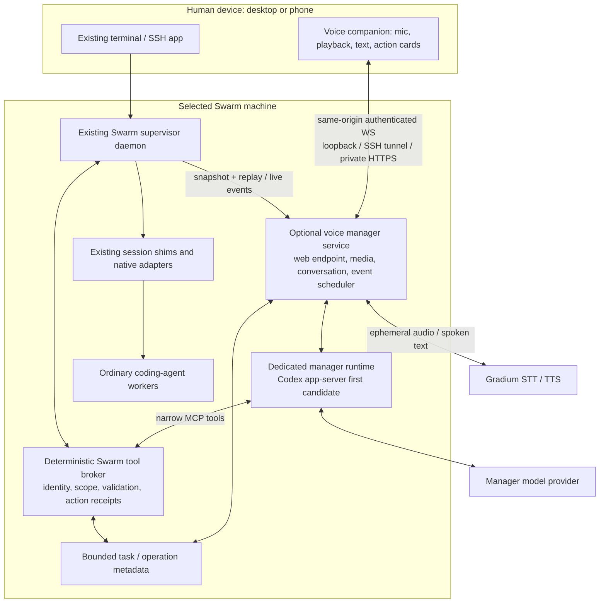

# A voice manager for Swarm: architecture and implementation framework

*2026-11-08 · Proposal, not an accepted ADR or shipped feature. Research bead: agents-tracker-1wxi.*

The useful product is a persistent Swarm manager that can listen, delegate, follow work and report results while the human moves between terminal and phone. Gradium can supply its ears and voice. Its current speech-to-speech product is live translation, not the conversational tool-using brain; the manager still needs a coding-agent runtime and Swarm's existing control contracts. The microphone and speaker belong on the user's device; the manager and workers belong on the selected Swarm machine. [Gradium S2S](https://docs.gradium.ai/guides/speech-to-speech-overview)

The proposed direction is **one optional manager service per Swarm place, one browser companion across devices, and existing Swarm workers**. Start with server-proxied Gradium STT/TTS over WebSockets and a dedicated Codex app-server manager with narrow tools. Qualify Claude as a manager alternative separately. Use loopback locally, SSH forwarding on desktop, and an independently reachable private HTTPS origin for the strongest phone workflow. This is a recommendation to decide, not permission to provision networking or implement the product.

The [landscape survey](gradium-voice-landscape-2026-11-08.md) compares alternatives. The [evidence package](gradium-voice-evidence-2026-11-08/README.md) contains retained probes and exact limits. Two Sol specialists and one Astra specialist researched provider internals, Swarm control, devices/UX/security, then challenged each other's findings. The approach follows the requested [ambition article](https://felixrieseberg.com/how-to-be-more-ambitious-a-tutorial-for-humans-with-models/): raw sources, falsifiable experiments, and independent criticism, with ambition concentrated on the complete human workflow.

## What was demonstrated

| Hypothesis | Result | What remains unproved |
|---|---|---|
| Local browser audio can avoid a native desktop application | PASS with isolated Chromium 145.0.7632.6 and its synthetic microphone. Both localhost and 127.0.0.1 supported capture and AudioWorklet. | Real microphone, Safari/Firefox/Linux, echo, permissions and device routes. |
| Browser processing can produce Gradium's 24 kHz input foundation | PASS: actual synthetic track reported 48 kHz; AudioContext/AudioWorklet delivered 24 kHz, 24,064 samples in 188 render blocks. | PCM16 encoder correctness, audio quality, real-device resampling and full speech transport. |
| The VM can serve the companion over existing SSH | PASS through actual `tf_nathan` SSH local forwarding: nonce matched, browser secure context/capture/AudioWorklet worked through the forwarded page. Remote fixture exited cleanly. | Audio was processed locally, not uploaded through the tunnel. No live STT/TTS or conversational latency result. |
| Ordinary HTTP to a remote address can be used the same way | Negative control: simulated nonloopback HTTP origin was insecure and had no microphone API. | A private network or SSH login alone does not make that browser origin secure. |
| Gradium streaming behavior can be inspected without new credentials | Eight exact upstream SDK-class mock checks passed; token and EU speech endpoints rejected unauthenticated requests with 401. Owner-identified earlier VM spikes also contain authenticated synthetic speech/browser results, reviewed below. | Fresh account/model qualification, human speech, ordering races, billing and cancellation resource release. |
| Existing worker controls provide a sound starting point | Focused pilot/protocol tests and seven native custody/recovery/isolation tests passed. | The proposed manager does not exist. Owner launch retry and native-input gaps below remain. |
| All requested phone workflows work today | NOT DEMONSTRATED. Official platform evidence supports a foreground design; no physical phones were available to this run. | Android Termux/browser and actual iPhone/client qualification are release gates. |

Read-only VM inspection found Linux and installed Swarm 0.25.1. The VM has `/dev/snd`; this is not evidence it can hear the client's microphone. At Nathan's subsequent direction, the relevant existing voice session's snapshot, native discussion and spike artifacts were inspected read-only; no session was changed or messaged. No real microphone was opened by this investigation. No new Gradium key was supplied; the owner will provide one after its console works again.

### Earlier live VM evidence recovered at the owner's request

The identified session had already run Gradium EU tests on 2026-11-08. This investigation read both its scripts and retained tool results; it did not rerun those paid/provider calls. A [sanitized evidence manifest](gradium-voice-evidence-2026-11-08/prior-vm-observations.json) records scope and source hashes. Private project code, raw discussion, account data and original artifacts remain outside this public repository. Its project-specific product decisions do not become Swarm decisions.

- A token whose reported expiry was about four seconds away produced `ready` on two separate TTS setups. A fresh token worked after two seconds and failed after six in that test. This conflicts with documented single-use semantics. Always mint just before use; do not rely on consume-once as a security boundary or hardcode a universal TTL.
- A bogus token still reached WebSocket open, then failed setup with `1008`. Readiness, not successful socket opening, is the useful authenticated lifecycle witness.
- Three synthetic TTS runs reported first audio 169/177/181 ms after first text. That excludes manager inference and much of the end-to-end interaction; it is a small prior sample, not a Swarm latency result.
- The prior Chrome browser streamed fake-WAV capture to live STT and separately scheduled live TTS output. It bypassed permission/autoplay policy and never ran STT/TTS together. It demonstrates a scripted provider/browser path, not real microphone, user-gesture, acoustic, duplex or phone qualification.
- Synthetic end-of-turn figures were biased by trailing silence. A new read-only analysis of two retained synthetic WAVs found approximately 437–455 ms below absolute PCM16 amplitude 32 at their tails (threshold-dependent). Human end-of-speech latency still needs measurement. The prior 1.1–1.5 s estimate is a correction hypothesis, not a human benchmark.
- Number/markdown and proper-name roundtrips exposed semantic risks; the TTS→STT oracle cannot isolate which model erred. Swarm needs a human-listened corpus for paths, session names, hashes, versions, amounts and identifiers, plus visible exact text.

This materially reduces basic provider uncertainty, but the token contradiction and methodological limits strengthen the need for fresh release qualification. It also makes manager first-response latency an early gate: a fast speech backend cannot hide a slow planning model.

## 1. Architecture and trust boundaries



The diagram is proposed wiring. The daemon, shim, native worker paths and much of the protocol exist; the voice service, manager scheduler and broker do not. Keep provider/media failures out of the daemon's synchronous control path. Reuse the existing Go WebSocket/client dependencies and service-supervision patterns where they fit. No Python, LiveKit deployment, or separate multi-agent engine is necessary for the first direct implementation.

**Process ownership:** a user service owns the voice manager; the terminal/browser connects to it. Closing the browser disconnects audio while delegated workers continue under their existing shims. A manager-service crash is a different event: reconcile exact pending operations and resume the saved manager thread before accepting mutations. The proposal does not promise uninterrupted reasoning or recovery of an in-flight model turn. Specify and test child PID/start identity, stop/wait and restart fencing rather than building a second shim-survival system accidentally.

**Data recipients:** Gradium receives microphone audio and the concise text selected for speech. The manager's model receives authorized instructions and bounded worker information retrieved for the task. The browser receives manager text/status/cards. None needs every worker transcript by default. Raw audio is ephemeral; task/action metadata is bounded. The existing [live-only storage decision](../adr/ADR-033-live-only-supervisor-storage.md) remains relevant to history and retention.

### Gradium integration

Use separate active STT and reply TTS requests initially. Validate setup/ready metadata, actual sample rate and resolved model; consume asynchronous input/output concurrently. AudioWorklet supplies Float32 audio; application code must downmix, clip and encode it into PCM16. That encoder was not tested here. The tested 24 kHz processing path halves bandwidth relative to 48 kHz; use actual supported capture rate if that path fails qualification. Gradium's provider wire uses JSON/base64, so the browser-to-service leg can use binary PCM while the service performs provider framing. The documented formats and lifecycle are in the [STT protocol reference](https://docs.gradium.ai/api-reference/endpoint/stt-websocket) and [shared lifecycle](https://docs.gradium.ai/guides/websocket-lifecycle).

Set required `json_config.language` explicitly. Current STT supports English, French, German, Spanish and Portuguese, with `any` for detection among supported languages. Multilingual names and technical identifiers need a corpus test; automatic detection is not universal language support. [Transcription settings](https://docs.gradium.ai/guides/transcription-settings)

Prefer a server proxy first: key custody, speech finality and metering stay together, and the UI uses one authenticated connection. A second candidate is browser-to-Gradium media using server-issued short-lived credentials documented as single-use; compare it with the proxy if the VM detour materially hurts mobile latency. The prior observed reuse means consumption cannot be assumed enforced. Direct media can carry human-authorized transcript/text input through the same scoped broker; server-originated STT alone is not proof of human authority. Gradium tokens do not authorize Swarm operations, and documented tokens have no demonstrated fine-grained spend/endpoint scope. [Browser WebSockets](https://docs.gradium.ai/guides/browser-websockets)

Do not treat `end_text`, semantic VAD, a pause, or a generated transcript as authorization to run a partial instruction. PTT release or a calibrated conversational endpoint proposes a boundary; correlate native `flush`/`flushed`, finalize the utterance, then admit one logical human turn. Reject late ASR results from old media generations. Current integration workarounds predate November's STT update; live tests must settle boundary races. [STT flushing](https://docs.gradium.ai/guides/speech-to-text#flushing), [November release notes](https://docs.gradium.ai/guides/release-notes/2026-11)

Buffer complete words and natural phrases before TTS. Never read raw model token fragments, tool arguments, chain-of-thought or full terminal output aloud. Consume audio according to real byte lengths; resampled output can start with a 40 ms chunk. Local interruption purges the device queue immediately and invalidates its speech generation; graceful EOS drains and is not cancellation. Provider compute/billing cancellation is unqualified. [TTS guide](https://docs.gradium.ai/guides/text-to-speech), [voice settings](https://docs.gradium.ai/guides/voice-settings#resampling-delay)

### Manager runtime and tools

Codex app-server is the first candidate because this repository already has its correlated RPC, unsolicited request handling and owned worker lifecycle patterns in [internal/appserver](../../internal/appserver/appserver.go) and [backendconnect.go](../../internal/skeleton/backendconnect.go). A manager still needs its own turn scheduler, tool configuration and process custody. Use an available model discovered from the installed runtime; benchmark speed/correctness before selecting a model tier. No inference availability or native-account entitlement was tested here.

The installed Codex 0.167.0 schema confirms `dynamicTools` is experimental. Prefer stable MCP tools for the first broker; an experimental app-server feature must not become an accidental compatibility dependency. Official app-server documentation describes persistent threads and turn control, while the locally generated schema identifies the actual installed boundary. [Codex App Server](https://learn.chatgpt.com/docs/app-server)

Expose a small tool set: list/capabilities, read worker state/output, create/resume, send, read operation receipt, interrupt when supported, read/answer a current request, and publish a human response. Names are hints; deterministic resolution pins machine identity, session ID and current instance. Duplicate names produce a short choice. Each mutation also binds task, logical action, exact payload and native request/turn coordinates when applicable.

Tool schemas alone do not constrain a coding CLI. Disable or fence unrelated shell/file/network/browser/plugin tools, project hooks and workspace instructions in the manager's effective runtime configuration; prove this using a hostile-project fixture and actual tool inventory. Keep the manager outside worker project directories by default. Unrestricted workers keep existing owner-authorized capabilities. If native-runtime isolation cannot be demonstrated, the owner must choose an explicitly unrestricted manager or an API-backed tool-only loop; do not call the former restricted.

Claude Agent SDK is a viable second runtime candidate with persistent input, interruptions and permission callbacks; this would be a new integration, not reuse of Swarm's Claude hook adapter. Qualify its actual CLI/account/distribution path before promising subscription reuse. [Claude streaming input](https://code.claude.com/docs/en/agent-sdk/streaming-vs-single-mode), [permissions](https://code.claude.com/docs/en/agent-sdk/permissions)

## 2. Every requested user journey

Command names below are proposed, not installed functionality.

| Situation | Launch / audio placement | User-visible experience | Required gate |
|---|---|---|---|
| Computer, local terminal | `swarm voice`; local browser and loopback endpoint | Start voice once; terminal remains ordinary Swarm. | Desktop real audio and supported browsers. |
| Computer, SSH to VM | Local `swarm voice --host tf_nathan`; reuse SSH alias/host-key verification and loopback forwarding | Browser identifies the VM; capture/playback run on the computer while audio streams through the VM to Gradium. | Real speech over tunnel, jump hosts, loss and reconnect. |
| Already inside SSH | Remote `swarm voice` prints correct connection instructions and reachable URL if configured | No attempt to open a VM browser or guess client microphone. Offer local-side command if no companion route exists. | Fresh-user onboarding in an already-remote terminal. |
| Android, Termux SSH to VM | Foreground browser companion, preferably independent private HTTPS; local SSH tunnel is an explicitly qualified option | Voice page shows task/status so constant app switching is unnecessary; Swarm workers survive terminal disconnect. | Exact Termux/browser/device; app switching, split screen, calls, routes, lock. |
| iPhone equivalent | Foreground Safari companion through private HTTPS/overlay; SSH-client tunnel only if proven | Same companion and manager contract. Same-phone link/code; QR only when another screen is available. | Named iPhone/iOS/browser/SSH client. Safari tab and installed PWA are distinct tests. |

An independent HTTPS route removes dependency on a background SSH app, but not browser microphone/autoplay/OS lifecycle limits. Tailscale Serve is one possible private endpoint if the owner accepts it; a plain tailnet IP over HTTP is insufficient. It adds installation/access policy and certificate-name disclosure. Authenticated owner-hosted HTTPS is another deployment choice, with more endpoint operation. No such service was provisioned. [Secure Contexts](https://www.w3.org/TR/secure-contexts/#is-origin-trustworthy), [Tailscale Serve](https://tailscale.com/docs/features/tailscale-serve), [HTTPS certificates](https://tailscale.com/docs/how-to/set-up-https-certificates)

**Release scope includes all three requested contexts and iPhone equivalence.** A desktop preview can precede phone qualification, but cannot close this product's goal. Foreground phone conversation is the smallest credible cross-platform contract. Talking while typing in another app, screen lock and background headset control are additional modes to select and qualify explicitly. Existing Android remote v2 is accepted architecture with open hosted/physical gates, not a ready-made voice deployment. [ADR-027](../adr/ADR-027-clean-remote-control-v2.md)

## 3. UX contract: speak an intent, see accountable work

The companion is a focused control surface. Follow Swarm's [existing visual direction](../design/swarm-illustration-direction/index.html) and Slate tokens, with a compact manager entry/status in the TUI. The TUI must not become an audio-device settings panel. Browser hotkeys work while that page has focus; a global terminal push-to-talk shortcut requires an actual integration and separate qualification.

```text
SWARM                         dev-vm · connected
Manager: Codex                Mic: this phone
Project: swarm                2 agents working

You: Find the SSH reconnect bug, fix it, and
have another agent review the change.

Swarm: Ada is investigating; Lin will review
the fix. I'll bring you anything that needs you.

Ada  Investigating       Lin  Waiting for fix

[Talk / stop listening]  [Stop speaking]
[Type a message]        [Show agent details]
```

This is a proposed wireframe, not a measured usability result. Show the selected machine, project and interpreted target throughout. Display a short editable transcript for names/paths/branches/numbers; clarify only material ambiguity. Never imply that a friendly spoken acknowledgement means the worker accepted the request. Announce an actual receipt: “Sent to Ada on dev-vm.” Report success with evidence such as the worker's test/review result, distinguishing self-report from independently verified checks.

Support hold-to-talk and tap-to-talk, typed input, keyboard and screen reader operation. Pointer cancellation/focus loss must release PTT. Start voice is a gesture that requests permission and unlocks output. Expose denied permission, ended/muted track, suspended playback, congestion and disconnected control as distinct recoverable states. Natural duplex is the target experience; PTT remains a complete option for public/noisy environments and precise identifiers. Editing a transcript before commit changes the proposed input; after dispatch it is a new correction, never an implied rollback.

Under the foreground-only contract, backgrounding, lock or track interruption pauses/stops capture and bounds/closes billable speech sessions while manager/worker progress continues. Browser lifecycle events may never arrive, so server leases/timeouts must enforce resource bounds independently. Audio resumes explicitly. Background operation, if selected, needs a different qualified lifecycle contract.

Four actions remain separate:

| Action | Meaning |
|---|---|
| Mute microphone | Stop capture/transmission of new audio. |
| Stop speaking / barge-in | Clear local playback immediately and reject late speech chunks. Worker actions keep their receipts. |
| Interrupt manager | Stop its active reasoning turn; reconcile already dispatched effects. |
| Cancel Ada's task | Exact target/turn-bound worker operation, only where that runtime supports it. |

Default “stop” during speech stops speech. Ambiguous task cancellation gets a brief target clarification. A spoken “yes” binds to one fresh presented proposal/request; it cannot approve a different pending request, an expired card, or anything suggested by worker text. Native provider permission remains separate from permission to delegate a task. Avoid an extra plan-approval ritual for routine work already within the user's scope.

Return silently after reconnection/unlock or a lost Bluetooth route; show current state and require an explicit audio resume. Never unexpectedly speak private output through a changed speaker. Device permission, authenticated identity and speaker recognition are different concepts; recognizing a voice is not authentication.

## 4. Reliability and security contract

The service has one manager-turn scheduler, a bounded task/event inbox and one active microphone owner per conversation. Worker events are coalesced while a turn runs; no second competing model turn or model call per token. Idle management requires no inference polling. Relevant completion/attention/error/loss events can schedule a turn after the human conversation has gone quiet.

Persist only what recovery needs: stable place/manager/conversation IDs, task-to-worker links, committed utterance IDs, exact pending action payloads/digests and operation IDs, receipts, last applied journal cursor, and current request/proposal references. Configure bounds, expiry and uncertain-operation retention; capacity exhaustion refuses new effects. Preserve replay guards for unresolved effects beyond cosmetic conversation expiry. A durable cursor does not preserve worker reply content: reconcile bounded generic history against provider-native output where available, and say when output was lost. Do not create a second durable worker transcript archive implicitly.

Logical action IDs outlive MCP/JSON-RPC call IDs and media chunks. Record an exact intent before effects; exact retry returns/reconciles the original outcome. Different payload under the same ID conflicts. A crash after a tool effect but before an LLM response must not dispatch it again. Audio reconnect creates a new media generation, drops incomplete speech, refreshes target/authority and queries unresolved receipts before enabling new mutations. Do not replay raw speech as a fresh instruction.

Use `JournalSubscribeFrom` snapshot/replay/live behavior and checkpoint only fully processed records. Deduplicate replay by cursor, reconcile history gaps and avoid adopting the snapshot head before replay has been processed. An event, idle state, process exit or provider input completion is not proof of task correctness. The [pilot runbook](../operations/pilot.md) already documents these distinctions and explains why a completed caller cannot wake itself.

Browser endpoints require exact Host/Origin checks, scoped authenticated sessions, CSRF protection, bounded messages/rates/backlog and no wildcard CORS. Bind SSH listeners explicitly to loopback. Pairing/bootstrap is one-use, expiring and machine-bound; remove bootstrap material from history/referrers and redact URLs. Voice endpoints expose broker operations, never the full owner daemon socket. Private overlay membership alone must not grant all coding permissions.

Bound the live audio queue by duration and bytes. When congestion exceeds the deadline, discard uncommitted capture with an honest retry prompt. A committed utterance awaiting ASR must reach an explicit accepted, failed or uncertain state before replacement; an accepted/dispatched action is reconciled by its original ID, never offered as a fresh retry. Local playback stop must function with the network unplugged. Revoke/takeover invalidates old media generations and pending proposals. Worker prose stays untrusted data, never system policy or an endorsement. Existing same-user unrestricted workers remain within Swarm's accepted owner trust boundary; this design does not claim a hostile-process sandbox.

## 5. Existing gaps and exact code reach

| Area | Existing implementation to reuse | Required shared change / qualification |
|---|---|---|
| Launch/resume | [client launch](../../internal/protocol/client.go), server remote reservation paths | Owner `Client.Launch` has no operation ID. Add exact owner launch intent/status/reconciliation before lost replies can be retried safely. Searching names/cwd is insufficient. |
| Semantic send | [semantic.go](../../internal/protocol/semantic.go), [semantic_status.go](../../internal/protocol/semantic_status.go), native custody | Preserve exact operation, incarnation and receipt correlation. No raw-key fallback on unsafe admission. |
| Claude/agy native ingress | [chat.go](../../internal/skeleton/chat.go), [claude_input.go](../../internal/skeleton/claude_input.go), [agy_input.go](../../internal/skeleton/agy_input.go) | Qualified native sink selection currently depends on nonnil Origin. Select by current sink proof independently of attribution; do not forge Discord origin. Preserve provenance hashing. |
| Observations/history | Journal subscription, [pilot_watch.go](../../cmd/swarm/pilot_watch.go), native history | Pilot view has 20 generic records then screen fallback. Use bounded typed reads; Codex downtime history is not automatically backfilled. |
| Interrupt/approvals | Existing strict expected-turn handler and native request contracts | Add only needed typed owner helpers. OpenCode strict Stop is unavailable; exact requests/decide is not a universal five-provider API. |
| Manager/runtime | [appserver transport](../../internal/appserver/appserver.go), owned process patterns, Discord service patterns | New manager package/service, MCP broker, effective tool restrictions, turn scheduler, state and restart reconciliation. |
| Product/CLI/UI | `cmd/swarm` dispatch and existing TUI styles | Proposed voice commands, embedded static companion, connection diagnostics and compact TUI entry. No new dependencies without need. |
| Tests/docs/distribution | Existing protocol fixtures and test supervisor | Update callers, schema hashes/capability negotiation if needed, fixtures, runbooks, privacy disclosure, install/config cleanup and release evidence. No new Actions triggers. |

Do not remodel all adapters or redesign the entire capability schema up front. Broker actions need truthful current support proofs. `StructuredChat` or an OpenCode-specific `NativeComposer` flag is not universal safe input/approval parity. Codex is the strongest first worker qualification; Claude needs the ingress change; managed OpenCode has shipped native operations but its stated Stop/status/longer-run limits remain; agy/Hermes require their actual session mode and capability evidence. See [current boundaries](../INDEX.md), [OpenCode operations](../ops/opencode-native.md), and [Discord native-admission evidence](../verification/discord-protocol/README.md).

## 6. Implementation sequence and promotion gates

These are proposed delivery waves, not an assertion that implementation is authorized. Beads is the execution tracker; this table describes architecture dependencies and acceptance evidence.

| Wave | Concrete result | Exit evidence |
|---|---|---|
| 0: ratify contract and close live unknowns | Owner decisions below; live Gradium corpus; exact desktop/Android/iPhone routes | Auth/flush/finality/cancel/billing tests; measured initial speech; chosen hardware/network requirements. Reject provider/transport if thresholds fail. |
| 1: reliable text manager | Owned persistent service + selected structured manager + narrow broker; no audio needed | Task creates workers once, follows events, asks exact questions, reports evidence; lost launch/send replies and manager restart never duplicate effects. Runtime tools are actually constrained. |
| 2: desktop speech slice | Companion + Gradium + local/SSH launch; PTT and typed fallback; early duplex | Speak → worker → result across local and actual VM; stop playback locally, refuse stale finals and modal misrouting; actual audio timing. |
| 3: complete mobile paths | Same companion on Android and iPhone through the selected route, plus chosen lifecycle modes | Physical device matrix, same-phone onboarding, app/call/network/route transitions. All requested contexts demonstrated before product completion. |
| 4: natural conversation and hardening | Calibrated duplex, attention summaries, quiet idle, spend limits, recovery/security/load tests | Name/path corpus, echo/self-trigger adversarial tests, fault injection, bounded queues, clean service removal and accessibility/usability studies. |
| 5: release qualification | Supported version matrix, privacy/runbook/upgrade docs and signed release | Repository build/vet/lint/tests plus required race coverage; actual Mac/Linux installed artifacts; sustained provider/device runs; owner-reviewed evidence. Tag-only CI policy preserved. |

Proposed targets for ratification: local speaker stop p95 <100 ms; committed PTT boundary to first meaningful spoken acknowledgement p95 <1.5 s on a defined good network; verified worker dispatch target p95 <3 s for a simple instruction excluding worker startup/model work. Complex planning may take longer and must show progress without a false completion claim. Report p50/p95 across at least 100 scripted turns per supported route, distinguishing STT commit, manager decision, dispatch receipt and TTS onset. These are targets, not measurements or vendor guarantees.

Every correctness fixture must include negative controls: lost reply after accepted launch; exact repeat and changed-payload repeat; duplicate utterance; late ASR after cancel; stale incarnation; similarly named workers; modal permission appearing during input; approval expiry/restart; event before subscription; journal eviction; malicious worker output; wrong-machine token; hostile Origin; slow reader; device takeover. No wrong-target action, duplicate accepted action, or inferred approval is acceptable. Retain an explicit uncertain result when certainty is unavailable; do not promise global exactly-once execution.

Physical provenance records device/OS/browser/SSH client versions, audio route, network and foreground/screen state. Test built-in speaker, wired/USB and Bluetooth, speech while assistant speaks, noise, incoming call, network handoff, permission revocation, app switch and lock. A 30-minute foreground test and an 8-hour managed-work soak are initial proposals; production support needs repeatable runs and recovery evidence, not a single demo. Provider-session rotation is required within that soak: current documented normal sessions last up to 3,000 seconds, L up to 7,200 seconds; verify the actual plan and rotation across an utterance boundary. Background mode, if required, gets its own longer OS lifecycle tests and possibly native clients. [Provider limits](https://docs.gradium.ai/guides/limits)

## 7. Decisions that need Nathan's take

| Decision | Proposed default | Why the answer changes the build |
|---|---|---|
| D1. Phone interaction contract | Foreground conversation; workers continue when app leaves foreground | Must voice also work while typing in another SSH app or with the screen locked? That may require native background audio and wider scope. |
| D2. Remote phone connectivity | Private HTTPS via an accepted overlay such as Tailscale; SSH-only desktop remains supported | Is installing an overlay acceptable, or must phones use existing SSH alone? Select one initial mobile route and name the actual iPhone SSH client. |
| D3. Manager identity/runtime | Dedicated Codex manager first, Claude next if desired | Prefer Codex, Claude, or both at first release? Must native subscription login be sufficient? Actual runtime/account and isolation must qualify. |
| D4. Delegation authority | Execute within the spoken task using existing worker permissions; exact questions for missing scope/permissions | Should the manager have unrestricted coding/shell powers, or only control workers? Which actions need owner confirmation, including publish/deploy/delete/spend? No blanket extra confirmation for normal delegation. |
| D5. Audio and retention | Cloud speech with explicit active mic; paid-plan ZDR; no raw audio retention | Is private project speech allowed to Gradium? EU residency required? Keep manager conversation text, metadata only, or ephemeral conversation? The Anthropic code standing authorization does not decide ambient microphone policy. |
| D6. Language and speaking style | Explicit primary language with optional mixed English technical vocabulary; concise acknowledgements/results | Which languages/accents and identifiers must work? Choose one initial voice; no custom cloning needed. |
| D7. Cost envelope | No idle model polling, capped speech sessions and usage visibility | BYO Gradium key or Swarm-provided account? Desired monthly/active-hour limit, model budget and hard-stop behavior? Shared provider custody adds a hosted product boundary. |
| D8. Product scope | One selected machine per conversation; include all named device contexts before complete release | Is cross-machine orchestration essential immediately? Are all five worker adapters required for first release, or explicit qualified subset plus clear unsupported actions? |
| D9. Phone product relationship | Companion independent of unfinished Android remote v2 gates | Should voice also be integrated into the Android app now? That is an explicit additional dependency; it does not deliver iPhone parity. |

D1–D5 are the main architecture choices. D6–D9 can start with the stated defaults only after owner scope is clear. An API key enables live provider qualification; physical Android/iPhone sessions are still required independently.

## 8. Cost and privacy facts to make those decisions

Published standard usage is `credits = synthesized characters + 3 × uploaded audio seconds`, before unverified rounding/minimum rules. One hour of continuous uploaded audio budgets 10,800 STT credits; ten minutes of speech at the provider's rough 750 characters/minute budgets 7,500 TTS credits. Twenty such days totals about 366,000 credits, excluding model, hosting, unused allocation and any hidden billing effects. Quiet connected time with no uploaded samples is not the same as continuous silence audio; measure actual metering before an always-listening promise. [Pricing](https://gradium.ai/pricing)

Current month-to-month tiers are XS $13/225k, S $43/900k, M $340/9M, L $1,615/45M credits; the page initially displays lower annualized monthly amounts. These are dated quotes, not a recommended purchase. Free tier lacks commercial-use entitlement. Paid ZDR is a setting to enable/verify, not a synonym for having a paid key. [Cost guide](https://gradium.ai/content/how-to-estimate-tts-costs-at-scale-credits-concurrency), [zero retention](https://docs.gradium.ai/guides/zero-data-retention)

Retention and regional processing are separate controls. Hard EU requirements need enrolled residency policy and verified session metadata, not merely an EU-looking hostname; verify `ready.residency` and the resolved endpoint/model. ZDR still retains usage/account metadata and does not make the manager model local. Avoid recording speech, transcripts, keys or token-bearing URLs in routine diagnostics. [Residency](https://docs.gradium.ai/guides/data-residency)

Without ZDR, no short speech-payload expiry was established. The DPA describes service-duration storage and deletion/return after termination within 45 days, with stated exceptions; inspect and enable the actual account setting before private speech qualification. [DPA](https://gradium.ai/data-processing-agreement)

The investigation establishes a credible architecture, desktop feasibility proofs and independently inspected prior synthetic live-provider observations. It does not certify current-account Gradium performance or any phone mode. Completing waves 0–5 with their evidence is the framework for earning the production-ready claim.
