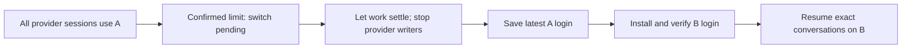

# A smaller subscription switcher for Swarm

Research on 2026-10-22 against `245cde5cb3f9b212290fe7e43d2ee1a5e91a9736`, tracked in Beads `agents-tracker-o4g9`. This is an investigation and proposed direction, not an implemented replacement or a new release qualification. Luna agents separately traced the implementation, researched each provider, exercised recovery, challenged the design, inspected migration, and tested upstream implementations. Production behavior and live logins were unchanged.

## Recommendation

Replace per-discussion account assignment with **one active subscription per provider**, once native continuation has passed the acceptance experiments below. Keep that subscription until an authoritative limit requires a switch. This is failover between subscriptions, not balancing each request or conversation across accounts.

Use one stable execution home per provider. Keep its settings, native history, trust and plugins in place; change only the provider's login material. Reuse Swarm's existing guarded stop/resume lifecycle. A small provider-level switch operation coordinates it: wait for safe boundaries, stop the old writers, save their latest credentials, install the next login, and resume the same native conversations. No proxy, parallel account cohorts, per-account configuration projections, automatic model changes, or replay of the failed prompt is needed for this product.

Three conditions remain unproved: a completed real model turn after A-to-B-to-A switching for both providers, a correct Claude Keychain/identity transaction on macOS, and reliable concurrent native token refresh with many sessions sharing a login. Those are the next experiments, before replacing the working paths or deleting legacy profiles. A green mocked test or an open terminal is not that proof.

## What Swarm does now

The implemented contract deliberately differs from the requested one. [ADR-028](../adr/ADR-028-personal-account-pools.md) gives each discussion an immutable provider/account/credential/configuration binding. Healthy discussions stay on their selected account. [ADR-032](../adr/ADR-032-light-organiser-drift-and-liveness.md) relaxed several configuration and liveness barriers but retained that architecture.

The current path is:

1. `bindAccountLaunch` selects an account for a new discussion; a managed resume inherits its source binding.
2. `prepareAccountLaunch` resolves a private account profile, checks CLI identity/version, projects native configuration, installs observation hooks, and records configuration provenance. The shim and backend use that binding.
3. Provider observations enter a durable account recovery inbox. Selection considers account/model scopes, quota freshness, denials, reservations and trial budgets.
4. Recovery preflights a destination, configuration, model and history; reserves it; claims and stops the source; verifies writers stopped; prepares history; starts one successor; and waits for native readiness before releasing input.
5. Account removal separately reconciles credential custody and deletion. Upgrade compatibility understands persisted bindings, projections, workers and pending recovery.

See [launch](../../internal/skeleton/accounts_launch.go), [recovery](../../internal/skeleton/account_rotation.go), [quota selection](../../internal/accounts/quota.go), [history](../../internal/skeleton/account_history.go), and [shim binding](../../internal/shim/accounts.go). The directly scoped implementation is **55 production Go files / 17,560 lines**, excluding tests and account wiring elsewhere. The [measurement](subscription-switcher-evidence/source-surface.json) deduplicates file globs. This measures the subsystem, not promised deletion savings: some credential, history and compatibility code remains necessary.

### A current failure reproduced

An ordinary owner Codex configuration edit can strand account recovery:

- Begin a quota incident and reserve a destination.
- Change the owner's `config.toml`, for example `model_reasoning_effort`.
- `PrepareNative` correctly prepares a new configuration reference.
- `preflightSuccessor` requires that reference to equal the source's old reference and refuses it.

The temporary overlay test observed `state=reserved`, `last_error=successor-preflight-refused`, **zero kills and zero launches**. It passed with race instrumentation because it asserts the defect's behavior; it does not demonstrate recovery. The lower-level test that accepts owner drift also passed for both providers. The mismatch is between those two layers. [Preflight equality check](../../internal/skeleton/account_feasibility.go#L61), [lower-level drift test](../../internal/accountconfig/native_drift_recovery_test.go#L11), [reproducer](subscription-switcher-evidence/source_config_drift_test.go.txt), [result](subscription-switcher-evidence/drift-summary.json).

This is a reproducible explanation for some failures, not a diagnosis of every failure the owner has seen. No live session logs or private conversations were collected. The older `configuration-writer-active` incident was corrected in Phase A; it should not be presented as a current bug. Bound resumes still deliberately refuse some failures where new selector-chosen launches fall back to the owner login, so enabling rotation changes the failure surface. [Fallback tests](../../internal/skeleton/account_owner_fallback_test.go), [Phase A residual](../verification/phase-a.md).

### What existing acceptance actually proves

The checked-in v0.17.6 evidence includes a real Claude managed answer and a running-discussion onboarding continuation which recalled an earlier marker. That is useful evidence, but is not a natural two-account quota-failover test. The same record reports Codex onboarding blocked at the time and leaves two-healthy-account failover open. Later release/unit/race checks do not silently close those native acceptance gaps. [Installed experiments and limits](../verification/account-pools-v0176.md), [current operating boundary](../operations/account-pools.md#post-deployment-acceptance-and-follow-up).

## External references: reputation and relevance

Discovery covered GitHub searches for both providers and broader account managers, then source inspection of the relevant designs. This is a screened landscape, not a claim to have inspected every repository online. Stars/forks were captured on 2026-10-22 in [repository metadata](subscription-switcher-evidence/repositories.json); they indicate adoption, not correctness. Primary sources and official provider behavior outrank project marketing.

| Reference | Stars at capture | Relevance and limit |
|---|---:|---|
| [CC Switch](https://github.com/farion1231/cc-switch) | 147,657 | Largest project reviewed. Broad provider/configuration management and managed Codex OAuth; substantially more than a native login switcher. Popularity does not establish Claude subscription hot-swap correctness. |
| [CLIProxyAPI](https://github.com/router-for-me/CLIProxyAPI) | 55,994 | Established OAuth proxy with credential routing, retries and session affinity. It changes the request path and adds another service; a poor fit for the requested lightweight native switcher. |
| [CodexBar](https://github.com/steipete/CodexBar) | 22,748 | Useful usage-observation reference. Repository metadata was screened; its adoption is not switch/resume evidence. |
| [Cockpit Tools](https://github.com/jlcodes99/cockpit-tools) | 19,239 | Broad account/desktop manager. Its Codex switch path includes explicit application restart support; it is not a small reusable Swarm lifecycle component. |
| [claude-swap](https://github.com/realiti4/claude-swap) | 3,812 | Strongest mature direct Claude reference reviewed: outgoing credential sync, account identity, locks, replacement and practical platform handling. Useful behavior and test reference; do not import its entire dashboard/polling/session feature set. |
| [CCS](https://github.com/kaitranntt/ccs) | 2,893 | Multi-provider/profile manager with CLIProxyAPI integration. Screened as another broader alternative. |
| [codex-auth](https://github.com/Loongphy/codex-auth) | 2,839 | Focused native Codex account manager; a more relevant source candidate than tiny snapshot scripts. Its source and tests are investigated separately below. |
| [codex-switcher](https://github.com/Lampese/codex-switcher) | 903 | Desktop account manager; screened for adoption, not treated as runtime proof. |
| [coding_agent_account_manager](https://github.com/Dicklesworthstone/coding_agent_account_manager) | 210 | Cross-provider reference that explicitly distinguishes a saved OAuth snapshot from an independent login. |
| [aisw](https://github.com/burakdede/aisw) | 134 | Explicit documentation about native credential ownership and running-process boundaries. |
| [2hmad/ccswitch](https://github.com/2hmad/ccswitch) | 7 | Closest simple Claude product shape: one account, shared native state, outgoing snapshot and running-process guard. Very low adoption; macOS support is explicitly experimental. |
| [edglz/ccswitch](https://github.com/edglz/ccswitch) | 4 | Small Go implementation and preservation/guard tests. A readable design example, not broad field qualification. |

The useful common pattern is **capture the latest outgoing login, replace only account-owned state, and account for running processes**. High-adoption projects still report token-copy divergence: [CC Switch issue 4474](https://github.com/farion1231/cc-switch/issues/4474) describes a refreshed token in one store and stale tokens in another. This is a reporter's observation, not our reproduction or a claim about the current fixed version. [CAAM's pinned warning](https://github.com/Dicklesworthstone/coding_agent_account_manager/blob/374c01de185d75b5d4f4bbe8369a460afb9a50f0/cmd/caam/cmd/profile_backup.go#L14) explains why two copies of one OAuth grant must not become independent refresh owners.

CLIProxyAPI's [pinned configuration](https://github.com/router-for-me/CLIProxyAPI/blob/ceb045a129d43f805e93a5e4aef3a59b108f34f7/config.example.yaml#L150) exposes routing, retry rounds, affinity and cooldowns. Those are capabilities a request proxy needs; they are not reasons to build them into a native subscription selector. Cockpit's [pinned Codex commands](https://github.com/jlcodes99/cockpit-tools/blob/76fbea02ba8ab5a071205a0bfa59ef4db5cc64b4/src-tauri/src/commands/codex_account_commands.rs#L672) corroborate restart handling, without proving Swarm conversation preservation.

### Upstream implementations tested

The best direct references reviewed are **claude-swap for Claude** and **codex-auth for Codex**, with official provider sources deciding native behavior. We ran their tests in scratch homes after inspecting the test isolation:

| Pinned source | Executed tests | Result | Proof boundary |
|---|---|---|---|
| `realiti4/claude-swap` `2b2d71c7aeb49e6bd25393509ceb05dbca7b0e10` | Switcher, Claude locks, locking, auto-switch | **856 passed**, zero failed/skipped | Synthetic credentials/usage, fake clock, in-memory Keychain and mocked OAuth |
| `Loongphy/codex-auth` `69fbf31a82c9cd5c0a5ff56a1045b8e3e3b6aa08` | Full Zig suite, including CLI integration | **465 passed, 8 skipped**, zero failed; 43/43 build steps | Synthetic auth, temp homes, fake daemon and curl helpers; conditional skips |

[Exact commands and boundaries](subscription-switcher-evidence/upstream-tests.json). These establish that the tested implementations satisfy their fixture contracts; they do not certify live subscriptions or Swarm integration.

`codex-auth` saves the currently active auth bytes before switching and offers opt-in shared-daemon coordination: try auth reload, defer if busy, otherwise fall back to restart. That is specific to its supported daemon/client topology; Swarm currently owns a backend per session. The checked alpha release has **no automatic hard-limit rotation**, and its active auth replacement is a direct copy, even though registry writes are atomic. No cross-process refresh/switch lock was found in that path. Borrow its behavior lessons, not these unqualified concurrency assumptions. [Pinned switch workflow](https://github.com/Loongphy/codex-auth/blob/69fbf31a82c9cd5c0a5ff56a1045b8e3e3b6aa08/src/workflows/switch.zig), [account sync/activation](https://github.com/Loongphy/codex-auth/blob/69fbf31a82c9cd5c0a5ff56a1045b8e3e3b6aa08/src/registry/account_ops.zig), [daemon-cache report](https://github.com/Loongphy/codex-auth/issues/162).

## Provider facts and tested hypotheses

### Codex

Official documentation supports file or OS credential-store auth and a configurable `CODEX_HOME`. CLI/IDE clients can share cached login state. A file switcher must know that **file mode is actually authoritative**; copying `auth.json` does not replace a keyring entry. `thread/resume` is documented, but it alone does not establish that a live model turn will succeed after changing subscription. [Authentication](https://developers.openai.com/codex/auth), [app-server](https://developers.openai.com/codex/app-server).

We ran the installed **Codex app-server 0.163.0** against a temporary home, synthetic account JWTs, and a mock HTTP backend:

| Operation | Account returned by `account/read` |
|---|---|
| Start using fake login A | A |
| Replace auth file with B; keep process alive | A |
| Stop that process and start another in the same home | B |

The result directly rejects “replace the file and every running Codex switches.” It does **not** test subscription validity, quota, token renewal or an authenticated conversation. [Runnable probe](subscription-switcher-evidence/native_codex_fake_auth_probe.py), [captured result and binary SHA-256](subscription-switcher-evidence/native-codex-fake-auth-result.json).

OpenAI source at `8eaf5fd115f036d207be236009938261758e30f2` explains the observation: `AuthManager` caches auth; some refresh paths conditionally reread disk for the same account. The source therefore does not justify the stronger claim that auth is *never* reread. A different-account file edit is not a supported fleet-wide reload mechanism. The refresh semaphore is per manager and the storage commit mutex is in-process; neither establishes cross-process refresh serialization. [Cached manager](https://github.com/openai/codex/blob/8eaf5fd115f036d207be236009938261758e30f2/codex-rs/login/src/auth/manager.rs#L2115), [guarded reload](https://github.com/openai/codex/blob/8eaf5fd115f036d207be236009938261758e30f2/codex-rs/login/src/auth/manager.rs#L2713), [storage mutex](https://github.com/openai/codex/blob/8eaf5fd115f036d207be236009938261758e30f2/codex-rs/login/src/auth/storage.rs#L175).

A second native probe observed **two overlapping OAuth refresh requests using the same synthetic refresh token** from independent app-server processes sharing a temporary home. Each child received a distinct loopback OAuth URL; the handler parsed the token and held the first request until the other child arrived. Both account/read RPCs completed in the final probe. This establishes an exercised concurrency gap, not a live `invalid_grant` failure. An exploratory run had a third refresh and a child initialization failure initially mislabeled as a timeout; the final harness distinguishes early EOF and first initializes the temporary SQLite state before starting concurrent children. [Final attributed observations](subscription-switcher-evidence/refresh-probe-result.json), [exploratory result](subscription-switcher-evidence/refresh-probe-exploratory-result.json), [probe](subscription-switcher-evidence/native_codex_concurrent_refresh_probe.py).

Stopping every writer during the credential switch does not fix concurrent refresh after all sessions restart. The existing [per-session Codex backend](../../internal/adapter/codex/backend.go#L26) makes that distinction relevant. Qualification must establish whether native recovery tolerates it; if it does not, evaluate a supported provider-native shared auth/daemon mechanism before adding any Swarm token broker. A custom OAuth refresh service is not part of the minimal proposal.

Do not log out of a parked account merely to switch: the upstream logout path can revoke its token. An account that expires or is revoked will still require native sign-in again; “connect once” cannot mean “credentials last forever.” [Logout implementation](https://github.com/openai/codex/blob/8eaf5fd115f036d207be236009938261758e30f2/codex-rs/login/src/auth/manager.rs#L3265).

### Claude Code

Anthropic documents separate `CLAUDE_CONFIG_DIR` directories for concurrent accounts. That also separates native configuration/history and does not match the requested single shared working context. On macOS, credential storage involves Keychain; external switchers also preserve the matching `oauthAccount`/`userID` identity while leaving unrelated settings alone. Native OAuth hot reload is not a documented guarantee. [Authentication](https://code.claude.com/docs/en/authentication), [settings reload](https://code.claude.com/docs/en/settings#when-edits-take-effect), [resume CLI](https://code.claude.com/docs/en/cli-reference).

`claude-swap` claims next-message file-backed switching and a Keychain cache delay; its source/test explicitly updates a shadow credential file to invalidate the cache. That is useful project evidence, not an Anthropic contract. A controlled restart avoids making Swarm depend on that timing. [Pinned implementation](https://github.com/realiti4/claude-swap/blob/2b2d71c7aeb49e6bd25393509ceb05dbca7b0e10/src/claude_swap/switcher.py#L7547), [cache test](https://github.com/realiti4/claude-swap/blob/2b2d71c7aeb49e6bd25393509ceb05dbca7b0e10/tests/test_switcher.py#L6686).

Two lessons from the smaller references are worth retaining: save the outgoing refreshed credential before activation, and change only account-owned fields. Their fake-Keychain tests do not validate actual Keychain ACLs, prompts, lookup names or crash behavior. Keychain plus identity JSON is **not one atomic filesystem rename**; Swarm must retain a pending intent and keep launches stopped until both agree. [2hmad switch implementation](https://github.com/2hmad/ccswitch/blob/91db2d95c37381a839076d2d76696b8acb01353d/bin/ccswitch#L167), [macOS test boundary](https://github.com/2hmad/ccswitch/blob/91db2d95c37381a839076d2d76696b8acb01353d/test/keychain.sh#L1), [Go preservation tests](https://github.com/edglz/ccswitch/blob/7986ff2f170f104f2a2c818f7f01443eb1c310dc/internal/core/service/switcher_test.go#L136).

### Swarm's existing recovery

Focused tests passed normally and under `-race` for account identity versus routine token refresh, busy/permission/composer deferral, kill/resume crash recovery, duplicate-resume prevention, candidate readiness, saved worktree/environment/options, and shim termination of agent/backend process groups. A temporary overlay also asserted that recovery sends an empty `InitialPrompt` with `resume_from`: it does not replay a prompt. [Coverage and limits](subscription-switcher-evidence/recovery-summary.json), [overlay](subscription-switcher-evidence/authwatch_no_replay_test.go.txt), [additional focused race results](subscription-switcher-evidence/root-focused-summary.json).

Reuse that lifecycle, but do not mistake it for a global switch barrier. It currently recovers discussions independently and can leave busy discussions on A while others start on B. Its automatic `AuthProbe` implementation is Codex-only; Claude's managed-pool observations follow another path. Backend readiness proves transport/thread attachment, not a completed authenticated model turn.

## Smallest proposed behavior

The provider has a selected login, saved login records, cooldown/re-login status, and at most one pending switch. Sessions keep their native conversation identity and ordinary recovery progress; they do not need a permanent account allocation.

- **Ordinary launches:** use the current native login through one stable provider home. No account-specific configuration compilation or quota probe on the startup path.
- **Activation:** mark the switch pending before changing anything. Serialize selection; deduplicate failures from the old provider generation. Pause new same-provider launches and new turns while letting existing work finish. Preserve approval/cancel controls required to finish or abandon work safely.
- **Stop boundary:** wait for the provider's Swarm-owned CLI and backend writers to exit before capturing auth. Do not snapshot first and hope a later refresh does not invalidate it.
- **Credential change:** save the latest outgoing login; install one destination login; read back matching identity. Keep unrelated settings, history and MCP credentials intact. A process crash during the change leaves a visible pending operation that reconciles before launches resume.
- **Resume:** use exact native conversation IDs and the saved checkout/options through the existing recycler. No fresh conversation substituted on resume failure; no failed prompt/tool automatically replayed. Keep a failed conversation available with its concrete reason.
- **Selection:** remain on the active login until failure; try the next locally eligible saved login in a stable order, once per incident. Respect known exhaustion/reset information, mark revoked credentials for re-login, and stop with a clear exhausted/needs-login outcome rather than spinning.
- **Trigger:** use provider-native evidence of a terminal subscription limit. Do not treat every 429, network error, stale percentage, 401, or `willRetry=true` as quota exhaustion. A Claude generic `rate_limit` signal still needs characterization to distinguish burst throttling from exhausted subscription capacity. A model-scoped limit needs an explicit policy before promoting it to a whole-provider switch; never silently change models.

Two constraints keep this honest. First, gentle switching plus one account for all writers requires waiting: a long tool or permission-held discussion can delay the whole provider. An implementation must display why it is waiting and allow cancellation, rather than force-kill useful work. Second, a provider home shared with a separate IDE/desktop/CLI has writers Swarm does not control. Stopping Swarm's shims cannot guarantee exclusive access to that store. Prefer one Swarm-owned execution home when external clients share the owner home; migrate native context once and keep it stable. Reuse an existing native home only when writer ownership is established. Do not reintroduce per-account settings copies to solve this.

An isolated execution home would become the native configuration authority for Swarm sessions, not a mirror continually overwritten from another home. That is a visible migration choice: edits in a separate desktop/CLI home would not automatically propagate. Writer ownership and this configuration choice must be settled during qualification, not hidden inside the switcher.

## Migration and deletion boundary

Keep historical account bindings as provenance while removing them from **new execution**. Do not relabel running managed shims or bulk rewrite their metadata. New resumed children can eventually use provider-wide selection while old source rows retain their original binding and projection.

Current schema-3 projections often already record an alias to the original native history root. `NativeHistoryAuthority` validates that authority; `HistoryProfilePath` intentionally permits history access after credentials become unusable. Older projections and copied histories still need their fallback reader. A canonical conversation ID alone does not prove its files are accessible in the new common home. [History authority](../../internal/accountconfig/native_projection.go#L228), [history-only profile lookup](../../internal/accounts/binding.go#L96), [current resolver](../../internal/skeleton/account_history.go#L729).

| Remove from the new runtime path after qualification | Retain or reuse |
|---|---|
| Per-session account choice, active-count balancing and account-move UI | One selected login per provider; add/remove/login UI |
| Per-account configuration projection/freeze/reprojection | Native configuration plus credential-routing checks at the auth boundary |
| Per-conversation account destination/trial state machine | Existing guarded stop/resume and one provider switch intent |
| Cross-account history transfer for new shared-home sessions | Native history readers; legacy aliases/copy readers until old history is reachable |
| Separate live-discussion pool onboarding | One-time legacy migration using exact resume |
| Duplicate token refresh in the switcher | Native refresh ownership, latest-credential capture and safe storage |

Persistence/upgrade readers for old bindings may outlive the active pool implementation because completed conversations remain retained. Legacy credential erasure must still wait for actual writer/reference release. No profile deletion is justified by this research alone.

## Acceptance that would change the recommendation

| Hypothesis | Evidence now | Next decisive experiment |
|---|---|---|
| Most current fragility comes from account ownership/configuration coupling | Source tracing and reproduced configuration-preflight refusal | Run the same launch/resume cases through a shared-home prototype with ordinary native settings changes |
| A credential file swap alone switches running Codex | **Rejected** on native 0.163.0 | Only reconsider with a supported reload mechanism and a successful same-process probe |
| Restarting selects the newly installed login | Native synthetic Codex account/read passed; official resume exists | Completed authenticated A-to-B-to-A continuation on both providers |
| Shared state avoids history/config duplication | Native history aliases and external switcher implementations support the direction | Preserve history marker, model, trust, hooks, MCP auth and worktree across two-account continuation |
| Existing recovery can own stop/resume | Focused normal/race tests passed | Two live disposable sessions, plus provider launch/input barrier and crash at each switch phase |
| Token snapshots can safely be parked | External sync-before-switch designs; stale-copy failure reports | Refresh while active, switch away/back, expire/revoke a parked login, and race multiple native writers |
| One shared auth file serializes all native refreshes | **Rejected** for the exercised native Codex path: overlapping requests observed | Determine live provider tolerance/recovery and supported native coordination; shared storage alone is insufficient |
| macOS Claude switch is a simple file replacement | **Rejected as a storage model**: Keychain and identity are separate | Real disposable-Keychain readback and crash reconciliation; Linux/file mocks cannot substitute |

The native acceptance should use two accounts of each provider in a throwaway project. A produces a marker; B resumes the exact conversation and answers a question that does not repeat the marker; switch back to A after refresh. Run a harmless tool counter to prove no duplicate execution, preserve each session's own ID/checkouts, and test both idle and busy sessions. Test Mac and Linux separately. Use injected limits for repeatable controller tests and separately record a genuine provider limit when encountered; do not burn paid quota to manufacture one.

Beads records the reproduced defect as `agents-tracker-solh`, native continuation/Keychain qualification as `agents-tracker-tdbt`, and refresh/writer-ownership qualification as `agents-tracker-zhiu`. The proposed replacement `agents-tracker-8vnr` depends on both qualification tasks. It should first make explicit switching work with exact resume, then connect the characterized hard-limit trigger, then remove obsolete active pool paths and reconcile documentation. Legacy history/upgrade readers are removed only when their retained state no longer needs them.

No live credentials, accounts, running Swarm sessions, or provider history were changed. One early fake-token Codex probe attempted external workspace discovery and received 401; the corrected probe directs backend/OAuth URLs to loopback and isolates HOME/cwd. It did not request a model turn. Configured loopback endpoints and recorded mock requests are not a packet-capture proof of all process egress.
