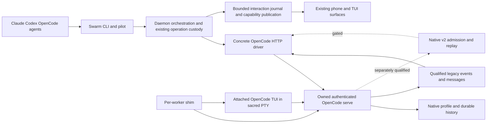
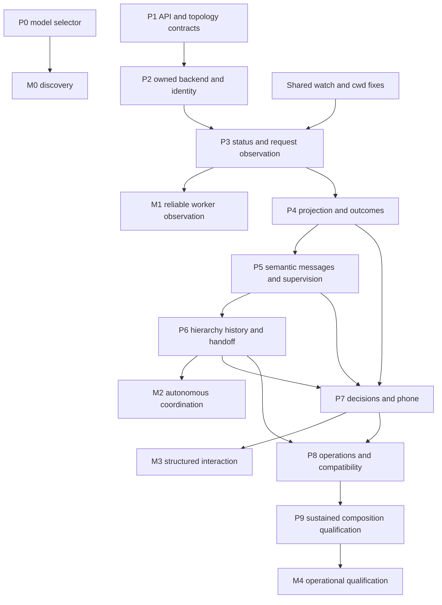

# OpenCode maturity implementation plan

This plan makes OpenCode a dependable Swarm worker for long-running work, cross-CLI communication, supervision, recovery, and structured phone interaction. It reuses Swarm's shim lifecycle, protocol, interaction journal, composer operation custody, and existing UI. It does not introduce another scheduler, broker, transcript archive, or provider framework.

**Implementation status:** model discovery for the existing launch selector is implemented locally in this work session. The native integration described below is proposed work. The [baseline audit](../verification/opencode-parity-2026-10-18.md), [model strategy reviews and new API experiments](../verification/opencode-plan-review-2026-10-18.md), and source are the evidence; schema availability alone does not establish runtime guarantees.

## Decisions and evidence

The target is parity with the **actual** Claude/Codex implementation, plus the reliability requirements needed for the owner's unattended workflow. Claude currently uses hooks and checked terminal input; Codex uses an app-server. Neither supplies universal exactly-once execution, both have qualified limitations, and the installed Codex 0.163.0 does not support Swarm's old ContextGuard range. OpenCode account rotation and Swarm-driven compaction therefore are separate capabilities, not prerequisites for useful basic parity.

| Decision | Reason and condition |
| --- | --- |
| One shim-owned authenticated OpenCode server, attached TUI, per worker | Preserve terminal close and daemon-crash survival, contain backend death, and bind observation/control to the actual running process. A per-worker server does not isolate the user's shared native profile. |
| Ship legacy HTTP/SSE observation first | Successful ordinary TUI replies and permission events are qualified. The newer durable API does not currently cover ordinary TUI activity in the tests below. Do not block the first useful monitoring slice on an incomplete runtime bridge. |
| Qualify newer `/api/session` capabilities individually | Caller-ID creation can be used with the legacy execution path after its binding/default/resume gates pass. Durable queue admission/retry/history survived restart, but ordinary TUI history and execution are not unified with that runtime; its admission/execution capabilities stay separately gated. |
| Persist native identity before useful work | Abrupt OpenCode death left Swarm unable to resume despite native history surviving. Never infer identity from newest session in a cwd. |
| Preserve explicit terminal verbs | `swarm send --key`, `--no-submit`, and terminal text remain terminal operations. Semantic agent/pilot messages use a separate negotiated route and receipt contract. Never silently fall back from an uncertain native write to PTY typing. |
| Keep native history native | ADR-033's bounded live supervisor remains the storage contract. Store small binding, control, outcome and checkpoint state; fetch conversation history on demand. |
| Leave the model field at the native default until explicitly selected | A catalogue is not a default. A default discovered in Swarm's cwd must not override another target project's settings. |

New experiments on OpenCode 1.19.3 changed the initial strategy:

- Caller-supplied v2 session IDs survive creation retries. A repeated create with a changed agent returned the **original** session rather than a conflict; the returned binding must be validated.
- A v2 queued prompt with `resume:false` and caller `msg_` ID returned one `admittedSeq`; exact retry returned the same admission, changed content returned 409, and these properties survived server restart. History replay and exclusive `after` worked for that admitted event.
- A legacy-created session is readable through v2, and a v2-created session is readable through legacy. This is **row compatibility**, not proof of shared execution or event coverage.
- Ordinary reviewer TUI conversations had empty v2 history despite successful replies. An attached TUI on a v2-created session produced `LEGACY_ATTACH_OK` through the legacy message path, while v2 history/projection retained only the earlier v2 admission/promotion. A v2 resume attempt did not establish a successful assistant reply in that probe. The two projections must not be merged by assumption.
- `serve --port 0` first bound 4096; a second concurrent instance chose an available ephemeral port. Let the native server bind and read its actual endpoint; do not build a check-free-port/close/rebind allocator or assume every zero request is purely ephemeral.

DeepSeek V4.1 Flash and GLM-5.3 Flash reviewed the strategy through actual Swarm OpenCode sessions, then responded to these findings and one another's objections. Their useful objections are incorporated below; their claims are not substitutes for contracts or tests.

## Scope and maturity milestones

| Milestone | User-visible result | Work packages |
| --- | --- | --- |
| M0 Discovery | OpenCode has the existing editable model selector; untouched forms preserve native defaults | P0, implemented locally |
| M1 Reliable worker observation | Exact native ID before work; actual busy, attention, error and settled state; resume and daemon recovery; read-only monitors work | P1–P3, shared workflow fixes |
| M2 Autonomous coordination | Correlated semantic messages and replies; safe passive supervision; native child attention; hands-off continuity across providers | P4–P6 |
| M3 Structured interaction | Phone transcript, request controls and supported Stop semantics, with honest degraded states | P7 |
| M4 Operational qualification | Supported macOS/Linux versions, bounded 24h/72h runs, upgrade/rollback, refresh and native compaction observation | P8–P9 |

M2 is the main gate for the owner's swarm workflow. M3/M4 complete comparable product maturity. Managed provider-account pools, external adoption, and Swarm-initiated compaction remain explicitly qualified follow-ons; core maturity must not imply that they are enabled.

The two confirmed shared bugs are prerequisites for using the advertised manual/handoff flows: `agents-tracker-79si` (watch flags) and `agents-tracker-xl6k` (actual worktree cwd). The existing native OpenCode work is tracked by `agents-tracker-93a`, `agents-tracker-dwwv.6`, and `agents-tracker-rz40`; new scoped work should reference these rather than silently closing them on partial progress.

Delivery is tracked by **`agents-tracker-vyhy`**. P1–P9 correspond to `agents-tracker-vyhy.1` through `.9`, with the dependency graph below recorded in Beads. P0 is `agents-tracker-rexa`; design/reviewer work is `agents-tracker-s6zn`. The existing identity/status issues depend on their corresponding delivery packages, and P3 also depends on the shared watch/worktree fixes. These IDs are the task tracker; this document is the design contract.

## Domain and ownership

| Term | Meaning |
| --- | --- |
| Swarm worker | One shim-managed CLI process/session with a Swarm instance and lifecycle |
| Native root | Exact OpenCode conversation to which that worker is bound |
| Backend generation | One owned server process incarnation, proven by PID/start-time and auth custody |
| Native input | One provider-admitted user/agent request, distinct from assistant tool steps |
| Native child | An OpenCode descendant session; not automatically another Swarm worker |
| Attention request | A currently pending permission or question addressed to an exact native session/request ID |
| Receipt | The known admission/outcome state of a specific operation; not an assertion of task success |
| History projection | Bounded read of provider-owned messages, separate from current turn/control authority |



Adapters stay pure. `internal/daemon` and `internal/shim` own resources; `internal/skeleton` composes them. A concrete `internal/opencodehttp` client owns bounded HTTP/SSE I/O, not worker lifecycle. Do not pretend HTTP is Codex JSON-RPC or create a general transport registry for hypothetical providers.

## Required behavior

| Requirement | Contract |
| --- | --- |
| OC-01 Selection | The existing editable picker offers exact native provider/model IDs, including built-in models and configured providers. No catalogue entry becomes an implicit default. |
| OC-02 Identity | Before any initial prompt, Swarm durably binds the worker to native root, effective provider cwd/profile and owned backend generation. A mismatch refuses action rather than creating another conversation. |
| OC-03 Lifetime | Terminal detach and daemon death leave the shim/server/TUI running. Shim/backend death is contained, identified and recoverable without wrong-thread adoption. |
| OC-04 Observation | Current state comes from the exact live server and session. Failed observation is unknown/degraded, never idle. An idle result is not successful task completion. |
| OC-05 Attention | Pending permissions/questions remain visible while parent or sibling work continues. Reconnect cannot silently supersede or clear a current request. |
| OC-06 Completion | Monitors correlate terminal outcome to the requested native input. Completed assistant tool steps, old history, compaction and unrelated idle events do not finish it. |
| OC-07 Admission | Native messages have explicit operation/receipt identity. Known rejection, conflict, admission, running, completion, failure and uncertainty remain distinct. Ambiguous side effects are not automatically replayed. |
| OC-08 Co-presence | Owner typing, another agent, phone input and native children coexist without forged attribution or cross-session input. Explicit terminal operations retain their existing meaning. |
| OC-09 Projection | Messages/tools/requests have stable native refs, bounded live caches and on-demand native history. Eviction does not erase live control authority or pending operation custody. |
| OC-10 Decisions | Permission/question answers bind exact request, native target, worker instance and generation. Preserve owner policy and exact scope; no prompt `tools` overrides or blanket auto-approval. |
| OC-11 Stop | A strict turn Stop is offered only with a proven native precondition that protects newer work. An unfenced session interrupt does not inherit Codex's expected-turn semantics. |
| OC-12 Hierarchy | Native children and Swarm worker lineage remain separate. Aggregate verified relevant descendants, retain active/attention state, bound traversal, and reject cycles/foreign targets. |
| OC-13 Continuity | Graceful and abrupt resume, handoff TO/FROM OpenCode, model/agent and actual worktree cwd are preserved. Missing/corrupt native history produces a named refusal. |
| OC-14 Capabilities | Each capability reflects this driver instance, version and current recovery state. A backend descriptor or readable history alone does not enable composer/approval/automation. |
| OC-15 Operations | Version change, compaction, auth/quota failure, sleep/reconnect and slow consumers have explicit outcomes and bounded resource use. No silent alternate-account retry after an ambiguous write. |
| OC-16 Monitoring | CLI/pilot/phone monitors checkpoint their own event domain, reconnect explicitly, and report gaps. Swarm cannot start a new model turn in an external host after that host's foreground tool wait/conversation ends. |

## Cross-component contracts

Names below describe required data and behavior, not an instruction to add a broad new interface for every row.

| Contract | Owner and consumers | Explicit and implicit obligations |
| --- | --- | --- |
| Backend launch descriptor | Adapter → daemon launch schema → CLI shim decoding | Closed backend kind, native listen policy, credential reference, required-managed startup; no shell commands/interpolation. Old Codex behavior remains compatible. |
| Native binding | Shim/core persistence → driver, resume, control | Native root, profile/cwd scope, worker instance, backend PID/start/generation, endpoint/version, launch custody; atomic durability before action. Secret value excluded. |
| Observation reducer | HTTP driver → engine and interaction capture | Exact source/generation, native work state plus request set, error/retry and input correlation; deterministic replay/snapshot fold; no terminal-grid overwrite of fresh native authority. |
| Semantic receipt | Owner protocol/pilot/composer → existing operation store and native sink | Immutable payload identity, native IDs when known, definite rejection/conflict/admission versus uncertain write; per-session serialization and bounded queue/backpressure. |
| Stable projection ref | Native driver → journal/history/detail/UI | Scope by native profile/root/object, not text equality. Backend generation fences live authority; reconnect must not duplicate the same historical object merely because the process changed. |
| Request set | Native root/children → approval/question authority | Multiple simultaneous IDs; exact choices/scope/hash; native resolution and stale reply handling; cache eviction cannot discard authorization state. |
| Checkpoint | Driver/native events and Swarm journal → monitor | Native aggregate sequences, legacy event IDs and Swarm cursors are different types. Never synthesize durable replay from a legacy SSE ID. |
| Resolved profile | Launch → server, TUI, discovery, resume | Same effective directory/config/auth/plugin sources. Narrow explicit environment handling, no credential import or arbitrary provider-key passthrough. |

### Launch and recovery ordering

```mermaid
sequenceDiagram
  participant C as Swarm client
  participant D as Daemon
  participant S as Shim
  participant O as OpenCode server
  participant T as Attached TUI
  C->>D: Launch with effective cwd and explicit selections
  D->>D: Persist launch intent and native identity custody
  D->>S: Start managed HTTP backend
  S->>O: Loopback serve with private auth environment
  O-->>S: Actual bound endpoint
  S->>S: Validate process and health; persist backend record
  D->>O: Subscribe and create or recover exact native root
  D->>D: Persist and re-read exact binding
  D->>S: Attach exact root; no standalone fallback
  S->>T: attach URL --session root --dir cwd
  D->>O: Admit initial prompt through qualified path
  O-->>D: Admission and correlated observations
```

For pinned 1.19.3, prefer narrowly qualified caller-ID session creation followed by the proven legacy execution/observation path; this does not enable v2 prompt execution or history authority. P1 must finish its binding/default/resume tests before enabling that combination. Persist the caller native ID before create. Repeated v2 create does not validate changed arguments, so verify returned profile/location/root and distinguish existing-session recovery from a fresh launch. A version using legacy creation instead needs a persisted random launch token in native metadata and qualified bounded ambiguous-create recovery. Neither path may select newest-by-cwd.

`attach` has no standalone model/agent/prompt flags. Apply selections through the qualified session/prompt API; prove that the first human prompt sees the intended model/agent. The current shim's 20-second fallback to original standalone argv is unsafe after native allocation: managed-required startup must fail explicitly or attach the exact saved root. Keep a terminal-only fallback as a separate **fresh launch choice before allocation**, not an automatic side effect after failure.

If daemon death happens after native admission but before receipt persistence, recover by stable native ID only where content-bound replay is proved; otherwise retain uncertainty. If a backend dies, disable native actions, retain identity/history and re-establish ownership before resume. If TUI `/new`, fork, session selector or `/resume` changes what is displayed, either rebind through a proven handshake or visibly suspend semantic actions. Never keep sending to an old hidden root while `peek` shows another conversation.

## Work packages in dependency order

### P0 Model selector and safe defaults

**Scope:** use native `opencode models --verbose`, parse exact provider/model IDs and display metadata, reuse `Detection.Models → overlayModelOptions → Suggest`. Preserve manual input and blank native default. Keep configured/default discovery out of this patch until it is tied to the target cwd. A failed catalogue remains an editable field.

**Current change:** bounded stdout, one five-second deadline plus up to one second of pipe cleanup, deterministic dedup/order and deprecated exclusion. The handoff form now honors only a declared `OptionSpec.Default`; the first suggestion is not a selection. Explicit existing Claude/Codex defaults remain intact.

**Files:** `internal/adapter/detect/{modelprobe,opencode_models}.go`, `cmd/swarm/main.go`, `internal/tui/handoff.go`, corresponding parser, discovery, overlay and handoff tests. Requirement OC-01. Independent of the native backend.

**Exit:** real catalogue includes built-ins and configured OpenRouter models; untouched launch/handoff omits model; cycling emits the exact selected ID; configured target defaults remain native; absent/broken/oversized/hanging CLI has bounded fallback. No model generation is part of discovery. Project-specific catalogues in a different selected directory remain a documented follow-up, not permission to prefill the wrong default.

### P1 Pin API behavior and owned topology

**Scope:** turn today's experiments into retained fixtures and a small pinned live contract suite. Select one primary API/runtime path for 1.19.3 and define the separately gated v2 capabilities. This is a bounded decision package, not a prerequisite to rebuilding every legacy feature.

**Files:** new native-client fixture/test package, `cmd/swarm-char` only if its existing characterization facilities fit, adapter version/capability tests, verification evidence. Requirements OC-02/03/04/07/14. Depends on no backend implementation.

**Tasks and contracts:** qualify same-session attached TUI, early identity, authenticated ownership, port fallback, session switches, profile/config consistency, permission/question routes, final versus intermediate assistant steps, native children, paging and event ordering. For v2, separately qualify storage/admission, actual model execution, ordinary TUI coverage, tool/request coverage and restart/replay-to-follow. Do not mark the entire API family supported because queue storage works.

**Exit:** a written version-specific contract says which path is authoritative for every event/action; ordinary TUI and agent-originated activity both reach that path, or unsupported semantics remain false. Separate caller-ID creation qualification from admission/execution qualification, so useful identity primitives do not require adopting the incomplete runtime. Retain the current v2 execution/projection split as a regression. Wrong credentials are refused; two server instances have distinct owned endpoints; stale-port health alone cannot pass readiness.

### P2 Shim-owned HTTP backend and early native identity

**Scope:** extend the existing backend lifecycle just enough for OpenCode; exact startup/resume ownership, containment, private auth and failure semantics. Read-only inspection is the first running vertical slice.

**Files:** `internal/adapter/backend.go`, `internal/adapter/opencode/`, `internal/daemon/{backend,launch}.go`, `cmd/swarm/main.go` launch decoding, `internal/shim/{backend,shim,server}.go`, new concrete HTTP client/driver, `internal/skeleton/backendconnect.go` dispatch, identity/persistence/reconcile tests. Requirements OC-02/03/13/14; depends on P1's chosen contract.

**Tasks:** add a closed HTTP backend kind and additive endpoint record; reuse process-group/PID-start containment and sole metadata writer; continuously drain bounded startup output; validate numeric loopback endpoint, disabled redirects/proxies, version/health and auth; add the pure characterized OpenCode native-ID validator; persist exact native identity before initial prompt; re-read after the first-wins setter to prove binding; attach the selected root without unsupported flags. P6 extends the generic external-resume/handoff consumers of that validator. Keep API credentials out of argv, URLs, roster, journal, phone and errors.

**Compatibility:** execution-critical managed-HTTP metadata must be rejected by older binaries/shims that cannot interpret it. Do not rely on an old daemon silently ignoring optional fields. Preserve old standalone records and Codex backend semantics; identify exact protocol/schema changes and the upgrade/downgrade refusal path before merging.

**Exit:** two workers in the same cwd cannot adopt each other's sessions; daemon SIGKILL preserves native PIDs and rejoin; server/shim death is contained; native ID survives crash at each create/persist/attach/admit boundary; native store remains intact. A failed managed launch never creates a second standalone conversation. Resume works without exit-screen extraction.

### P3 Authoritative status and current request observation

**Scope:** deliver reliable `ls`, `watch`, `peek` context, pilot attention, and passive-source readiness through native observation. Ship legacy HTTP/SSE here unless P1 establishes a fully integrated newer runtime. No permission write UI is required to make pending requests visible.

**Files:** OpenCode pure event/status shaping, concrete HTTP driver, `internal/engine`, `internal/status`, `internal/skeleton/{backend,interaction,capability,directinput,supervision}.go`, CLI/pilot status tests. Requirements OC-04/05/06/12/14/16; depends on P2 and shared watch/worktree fixes.

**Tasks:** maintain root plus verified active descendants, current work, retries/errors and a set of all pending permission/question IDs. Define attention precedence explicitly: an actionable request remains visible while sibling work continues. Do not simply set `InteractionPermission` while leaving active priority unchanged and call the bug fixed. Distinguish provider-busy from waiting-for-owner and from an unresolved Swarm input.

Legacy recovery subscribes before fetching current snapshots, buffers within a fixed bound, reconciles touched native objects and withholds unsafe actions when ordering remains ambiguous. A missing idle-map key is meaningful only after a successful correctly scoped read. Overflow, parse failure or stream loss degrades/reconciles; it is not evidence of completion. A native v2 sequence, when qualified, is per aggregate and public sequences need not be contiguous.

**Exit:** a real successful reply wakes an already-armed pilot watch; permission/question/error/retry is visible and clears only on native evidence; a tool-step completion does not release the turn; no false idle while a relevant child is active; wrong-server empty `/active` does not authorize anything. Test direct-input safety markers clearing on actual correlated progress. Status commit-to-local-subscriber remains within existing L1's one-second bound under declared load.

### P4 Bounded structured projection and correlated outcomes

**Scope:** normalize user/assistant/tool/plan/file events and operation outcomes into existing interaction/history seams. This supplies the truthful reply signal consumed by monitors and later messaging/control.

**Files:** OpenCode `InteractionSource`/normalizer, `internal/skeleton/{interaction,chat,capability}.go`, existing journal/history/detail folds, native HTTP history client, corresponding source/fixture/integration tests. Requirements OC-06/09/14/16; depends on P3.

**Tasks:** define native input execution boundaries separately from assistant messages; intermediate `finish: tool-calls` cannot close a turn. Hydrate old history without manufacturing live completions or old approval authority. Derive stable item IDs from scoped native refs where possible; bound all remaining mapping tables, including the current session-lifetime `itemIDs` growth. Preserve requested-message outcome even when a later prompt is active.

Reuse existing pending-send/history/detail and wire bounds rather than inventing another archive. Specify page, byte, event, queue, timeout, traversal and RAM budgets in P1 fixtures; oversized native content is represented through bounded details/native refs or an explicit gap, not an unbounded allocation. Keep small outstanding operation/request control state outside ordinary cache eviction. ADR-033 does not promise to bound OpenCode's own SQLite history/WAL; measure and state that separately.

**Exit:** multi-tool, retry/error, cancelled, declined, failed and successful inputs have correct terminal outcomes; history import and reconnect do not wake old completions; duplicate/late events and moving pagination converge; ordinary cache maps/logs remain bounded in a synthetic high-rate run. Outcome means execution outcome, not verification that generated code satisfies its task.

### P5 Native semantic messages and cross-CLI supervision

**Scope:** add a narrow owner-tier semantic submit/receipt seam for pilot and agent callers; reuse existing composer-operation custody and serialization. Preserve `send`'s terminal/key/no-submit contract.

**Files:** owner protocol/client schema and capability negotiation, `cmd/swarm/pilot.go` and one deliberate semantic CLI entry point, `internal/skeleton/chat.go`/operation custody/supervision, OpenCode sink, existing Codex/Claude compatibility paths and tests. Requirements OC-07/08/16; depends on P4 and P3's multi-request observation.

| Receipt state | Meaning and retry rule |
| --- | --- |
| Rejected/not sent | Validation or a proven pre-write failure; no native effect established |
| Conflict | This native/operation ID is bound to a different immutable payload; refuse, do not relabel uncertain or reuse it |
| Admitted | Native acceptance is established with correlated ID; this is not model completion |
| Running | Matching native input has begun execution |
| Completed/failed/declined/cancelled | Matching terminal native outcome; task success is a separate judgment |
| Uncertain | Bytes may have produced a native effect but its identity/outcome is unproved; reconcile or require intervention, never blind auto-replay |

Legacy `prompt_async` success can yield definite admission only to the extent its response/history identity is qualified; a timeout after sending is not safely retryable. Caller message IDs alone do not prove content-bound retry safety. Native v2 admission may remove this ambiguity once its actual execution/TUI path passes P1; today's queue-storage result is insufficient. Preserve the payload identity and scope across retries, process restarts and model switches.

For busy workers, use only a qualified native queue/steer contract. Otherwise return an explicit bounded busy refusal or uncertainty instead of inventing a durable Swarm inbox. Do not require a new generic messaging broker. Supervisor notices remain daemon-authored IDs/state, are revalidated at the real admission boundary, and do not embed child-authored instructions. Exactly-once PTY notice delivery is not promised.

**Exit:** actual Claude→OpenCode, Codex→OpenCode, OpenCode→Claude, OpenCode→Codex and OpenCode↔OpenCode messages, replies and monitors pass. Test same-text/different-ID, same-ID/same-body, conflict, event-before-response, response loss, daemon death at every write boundary, busy/modal/queued recipients, owner typing, controller release and stale session generation. No native write silently falls back to PTY. Passive notification works with OpenCode as source and as child, including restart before pending-event clearing.

### P6 Native hierarchy, history, resume and handoff continuity

**Scope:** complete provider-aware identity/history resolution and handoff source support, with exact current checkout and native child relationships.

**Files:** OpenCode ID validation, `internal/adapter/identity.go` conformance, `internal/skeleton/{api,resume_history,resume_migration,livename}.go`, handoff templates/CLI/TUI, history/export resolver, child aggregation and tests. Requirements OC-02/12/13; depends on P4/P5 and owned backend recovery.

**Tasks:** retain strict UUID validation for Claude/Codex while adding explicit characterized `ses_` identity support in generic seams that currently hardcode UUIDs. An `AsTranscriptLayout` implementation alone is insufficient: native OpenCode history is SQLite/API-backed, not a portable JSONL file. Produce a bounded provenance-labeled snapshot/export from the exact native session, including declared truncation/gaps. Do not point a successor at an entire live database or newest-by-cwd candidate.

Native descendants get their own refs and attention targets, not fake Swarm workers without shims. Bound traversal/depth/cycles, scope active children to current relevant execution, and do not keep every historical child active forever. Names/models/agents/worktree cwd follow native authority where supported, while controls remain tied to the declared root. Session switches must be handled before native messaging is enabled.

**Exit:** same-provider and cross-provider handoff TO/FROM OpenCode preserve source history, chosen model/agent and actual `ProviderCwd`; abrupt death resumes exact history; native child tools/requests and parent waiting are visible; missing profile, corrupt store, mismatched ID and fork/switch produce correct refusal/rebind. Historic native children do not prevent future idle forever.

### P7 Permissions, questions and structured phone controls

**Scope:** act on observed requests and publish structured conversation/control only after their authority is reliable. Multi-pending storage is already present from P3; this package adds decision application and UI wiring.

**Files:** existing approval/interaction/protocol schemas, `internal/skeleton/{approval,inject,chat,capability}.go`, OpenCode decision/interrupt client, phonecore/mobile facade/Android screens and gates as required. Requirements OC-05/08/10/11/14; depends on P4/P5 and P6's native child binding.

**Tasks:** preserve multiple exact native root/child permission IDs; sign/bind actions with existing remote authority and exact request content/scope. Resolve only after native confirmation. Race an owner TUI response, request replacement, expiry, duplicate click and lost HTTP reply. Qualify `once`, `always`, `reject` separately; the effective always-pattern must be visible and match the actual native decision. Legacy and v2 request shapes are not interchangeable.

Questions need distinct choices, multi-select/custom-answer semantics and request authority; do not disguise every question as an approval. If the existing interaction schema cannot express this, add a negotiated versioned extension through protocol, facade and Android consumers, with older clients retaining terminal/status fallback. Never widen native permissions by serializing prompt `tools` or injecting an owner policy replacement.

Strict turn Stop remains disabled unless native preconditions prevent an old action from interrupting newer owner work. Today's session-scoped abort/interrupt APIs have no expected-turn argument. If only session-wide stop can be offered, it needs an explicit product contract and accurate label; do not silently weaken the existing strict capability. Characterize child/tool cancellation and queued-work survival after stop.

**Exit:** root plus two child requests and a question coexist; resolving one affects only that ID. Every once/always/reject/question/stop action passes stale/replay/owner-race and generation tests. Machine, phone and TUI show the same authoritative result. Capability publication and degraded/reconnect states reach the real gateway and client assemblers, not merely a unit seam.

### P8 Lifecycle operations and provider compatibility

**Scope:** integrate safe native configuration, authentication/quota errors, model/agent discovery by actual target cwd, CLI refresh, observed compaction, upgrade/rollback and operational diagnostics.

**Files:** environment policy and selected adapter host probes, native profile resolver, `cli_refresh`, authwatch/account boundaries, context observation, doctor/refresh status and runbooks; existing release/version gates. Requirements OC-01/03/13/14/15; depends on P6/P7.

**Tasks:** keep server/TUI/resume on the same native profile; narrowly support required OpenCode/XDG configuration references without passing arbitrary secret environment variables. Provider credentials remain in native custody unless an existing explicit managed-account flow applies. Detect quota/auth/model errors as actionable outcomes; never silently switch model/account after an ambiguous admission. Cache discoveries only where invalidation/context is explicit.

Qualify native automatic compaction and preserve input/turn ownership across it. Historical token totals are not live context occupancy. Swarm-driven compaction requires exact occupancy and limits, safe effect windows, supported versions and continuation ownership; leave it unavailable without those facts. Safe CLI refresh needs durable identity, actual idle, no pending requests/drafts/uncertain operations, no unsafe worktree migration and proven resume. Existing Claude/Codex limits remain unchanged.

Account pools need a separate design for `(harness=opencode, native provider, account/profile)` rather than treating all OpenCode models as one credential type. Linux-managed enrollment, rotation, billing policy, native OAuth and external session adoption are separately gated work. Do not equate Basic auth to the local backend with authorization to access a model-provider account.

**Exit:** an installed CLI change cannot strand or duplicate a discussion; upgrade/restart and rollback understand or explicitly reject managed-HTTP records; quota/relogin/compaction do not create false completion; supported custom config paths work across resume. Doctor reports sanitized endpoint ownership/version/binding/gap diagnostics without secrets. Provider-account and proactive-compaction capabilities stay false unless separately qualified.

### P9 Composition and sustained-operation qualification

**Scope:** prove all completed package contracts together before making native OpenCode normal for qualified versions. This is a composition gate, not another implementation framework.

**Dependencies:** P1–P8 plus existing watch/worktree fixes. Use deterministic fake HTTP servers for ordering/fault schedules, versioned fixtures for payloads, and a small live provider matrix for native guarantees. Preserve release-tag-only CI policy; do not add scheduled/branch workflows.

| Scenario | Required evidence |
| --- | --- |
| Input → tools → request → tools → final answer | One correlated operation; no premature completion at tool-step or first idle |
| Root and multiple child requests | Correct attention precedence, stable exact targets and independent resolution |
| Two workers in one cwd/profile | No latest-session guessing, wrong-server idle, cross-root writes or duplicate adoption |
| All three harness directions | Send, monitor, supervision, resume and handoff matrix through actual CLIs |
| Write-boundary faults | Before write, partial write, admitted response lost, receipt persistence lost; safe rejection/admission/uncertainty and qualified retry |
| Feed faults | Duplicate/late/malformed/oversized events, moving pagination, slow consumer, disconnect/restart, retention or unknown schema gap |
| Identity drift | `/new`, fork, session selection, profile change, native store loss, server/port/PID reuse |
| Stop and decisions | Old-turn/new-turn race, owner-versus-phone reply, duplicate/stale decisions, queued input after cancellation |
| Lifecycle faults | Daemon/backend/shim SIGKILL, abrupt provider death, detached terminal, macOS sleep/wake, Linux process cleanup |
| Rollout and rollback | Old/new client/daemon/shim, live preexisting standalone sessions, unsupported native versions, downgrade refusal without lost native history |
| Bounded soak | High-rate deterministic fixture, then 1h live load, 24h supported-host run, then 72h unattended run with periodic real tasks and fault injection |

Before each soak, declare fixed budgets for RSS, goroutines/FDs, live item/ref maps, SSE queues, HTTP payloads, per-worker and aggregate Swarm disk/log growth, reconnect convergence and notification latency. Reuse existing bounds (`maxPendingSends`, history/detail/wire limits) where applicable; publish new caps only after real payload characterization. Measure native history/WAL growth separately. A successful idle ten-minute process is not a long-running workload qualification.

**Release exit:** build, vet, lint, package and whole-repository tests, race checks, relevant Android/facade gates and actual-host evidence pass. Qualified version/driver capabilities become default only after M2 safety and M3 controls pass; existing standalone workers are not forcibly migrated. Normal distribution follows the repository's release/tag/update procedure, not copying a development binary over Homebrew symlinks.

## Dependency and delivery order



P1's optional v2 experiments can run alongside the legacy observation implementation after the primary legacy contract is pinned. They do not gate M1 unless legacy ownership/observation itself fails. P3 must establish all pending request identities before P5 permits concurrent supervised work; decision writes can wait for P7. Pure shaping and fake-server work can parallelize once their explicit data contracts are frozen; process launch, identity persistence and integration remain one coordinated lane.

## Implementation discipline

- Begin each package with one failing test for its promised behavior and one adversarial interleaving or negative control. Reuse current harnesses; do not mock the business logic being certified.
- Give independent Sol/Astra implementation/review lanes exact files, contracts, inputs and acceptance criteria. Use the requested external models as additional critiques, not authority over invariants. The integrating agent owns composition and final checks.
- Keep adapter functions pure, preserve validation/error handling, avoid dependencies for small parsers and keep code at actual existing boundaries. No broad refactor of Codex or mobile merely to make OpenCode look symmetric.
- Commit/review one work package at a time, record exact supported versions and evidence, and close Beads work only against its acceptance criteria. Markdown sections are design, not a second task tracker.
- A failed qualification produces a named unsupported capability or revised decision. Do not bypass uncertainty with screen matching, timeout-based completion, latest-by-cwd identity, duplicate sends, permission widening or a second hidden conversation.

## Remaining design gates

The primary legacy path is selected for early observation, not assumed sufficient for every action. P1 still must qualify complete attached-TUI event/request coverage, lost-create recovery, native busy/send rules, and execution/cancellation semantics. The newer v2 path has promising durable storage but a measured runtime/projection split; adopting it for semantic actions requires a successful same-runtime model/TUI/permission/child test, not only stored admissions. Strict Stop without an expected-turn precondition may require an upstream change or an accurately different product capability. These are explicit build gates, not omitted work.
