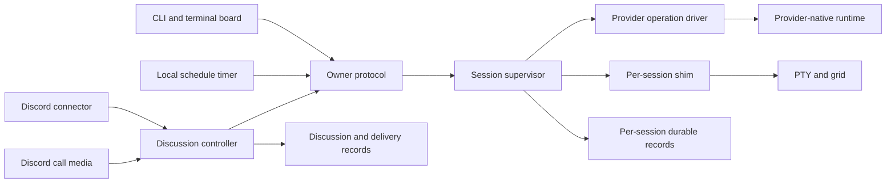

# Rust migration decision and delivery roadmap

**M0–M2 passed on November 26, 2026.** Work continues on `migration/rust-parity`. The release decision depends on the remaining operator, compatibility and qualification gates. [Milestone evidence](../../verification/rust-migration.md#reference-harness-and-runtime-milestones)

Build the smallest complete daily workflow first. From the familiar board, launch a fixture worker, attach, type, detach, restart the daemon, reattach to the same process, inspect its screen and stop it. Run the same interaction against the shipping Go binary. This slice buys an early answer to the expensive question: can Rust preserve the terminal experience and process survival at the same time? Start independent capture of provider, Discord, scheduling and upgrade behavior on day one. Those contracts take longer to learn than the scaffold takes to build.

## Pin the two references

| Reference | Contract and use |
|---|---|
| [GitHub main at v0.29.24](https://github.com/Nathandela/swarm/tree/a716dd50a5faf746ce6f0831fc31d0d73b06ffeb) | Current shipping reference for terminal, adapters, automation, Discord discussions/files/status, storage and distribution. Build and label this binary separately. |
| [Discord call resilience at da7b9f2d](https://github.com/Nathandela/swarm/tree/da7b9f2dfa7e2c6960bd860a72459c0448845c82) | Independent additional reference for Discord calls, media helper, consent, speech and worker continuity. Compare call-specific behavior with this binary and its matching helper. Its merge base with main is `22f3090d`. Current main remains authoritative for subsequently released text/file/manager fixes. |
| [Agentic Codebase Manifesto](https://github.com/Nathandela/agentic-codebase-manifesto/tree/37dcf6814b2e47d7996aee95653fa34d21152dc6) | Upstream HEAD matched [vendored provenance](../../governance/PROVENANCE.md) on inspection. Use invariants, mechanical constraints, navigable docs and independent review. All gates run on explicitly invoked local machines. |
| [System requirements](../system-spec.md), [invariants](../../invariants/system-invariants.md), [documentation index](../../INDEX.md) | Reuse retained requirements and later amendments. Some historical documents describe phone features or experiments. Resolve conflicting evidence per operation against the pinned source, tests and an observed run; record discrepancies. |

Before each milestone and the final freeze, compare new main commits to the last reviewed SHA. Classify each user-visible delta as retained, retired or separately proposed. Add retained behavior to both the scenario ledger and the candidate before advancing the pin. Record upstream-only branches such as `feat/discord-ticket-admission` as discovery items. Promote a feature from such a branch only with evidence of daily use or an explicit scope decision. Never merge the entire call branch to manufacture a combined oracle. A mixed text/file/call scenario needs independent assertions from each reference.

**Implementation tracking.** Beads epic `agents-tracker-8fp1` owns M0–M11 in order as child issues `.1` through `.12`, with blocking dependencies. Use `bd show agents-tracker-8fp1` to inspect the open implementation milestones. The [top-level CLI inventory](reference-surfaces.tsv) covers the default invocation and every switch arm in the pinned main dispatcher, including internal roles and aliases. The [board control inventory](reference-board-keys.tsv) ties gestures, state guards and retired controls to their Go handlers. Complete individual options, destination-screen controls, configuration, artifacts and positive/refusal scenarios during M0.

### Running the first milestone

From the repository root, run the following on a machine with Git, Python 3 and the Go toolchain installed. Choose a new output directory under an existing parent. The builder reads both pinned commits from the local Git object store. Fetch the call integration branch if the checkout lacks its commit.

```sh
python3 scripts/verification/build_rust_references.py /tmp/swarm-m0-references
```

Use the two CLI paths and SHA-256 digests in the resulting `manifest.json` for local comparisons. Each executable must answer `version` and `discord --help`; only the call reference exposes `stop-call`. The separately verified published macOS artifact is recorded in [reference checks](reference-checks.md). A live call also requires its matching media helper and a designated test place.

Before comparing latency, align the actual executable architectures of both arms. On the kickoff machine Go defaults to darwin/amd64 and Rust to aarch64-apple-darwin. Prefix the build command with `env GOARCH=arm64` when comparing with native Apple Silicon Rust. Keep the manifest with the results.

Current phase results and open qualification gates are recorded in the [fleet verification log](../../verification/rust-migration.md).

## Reading and ownership

| For this decision | Start here |
|---|---|
| Rust ownership, concurrency, library selection and local enforcement | [Rust implementation design](rust-design.md) |
| Where current source belongs and which consumers survive | [Source disposition map](source-map.md) |
| Terminal appearance, input ownership, wire protocol, durable sessions and mixed-version limits | [Terminal and runtime](terminal-runtime.md) |
| Provider and operation differences, automation, discussion history, workspaces and native authentication | [Providers and workflows](workflows.md) |
| Discord gateway, discussions, native manager, delivery/files and calls | [Discord and calls](discord.md) |
| Two-build replay, visual review, failure injection, performance, release evidence | [Parity and debugging](qualification.md) |
| Dependency removal, installation state, release and rollback | [Retirement and release](transition.md) |
| Human interaction scripts and release-day operator trials | [Operator trials](operator-trials.md) |
| Failure cases that could invalidate the design | [Independent challenges](challenges.md) |
| Local observations made while preparing this roadmap | [Reference checks](reference-checks.md) |

### Working vocabulary

A **place** is an independently configured Swarm installation in Discord. A **discussion** is the durable conversation a user addresses. A **session** is Swarm's lifecycle record. An **instance** identifies one live realization. A **native conversation** belongs to a provider and can survive replacement of a process. A **shim** owns the PTY and its grid. An **operation** has an identity that survives retries. A **receipt** states what the responsible owner can prove about that operation. A **lease** controls interactive input/resize for one generation. Model these identities separately. In particular, a Discord channel, a native thread, a PID and a session ID have different lifetimes.

## Architecture decision

Keep one installable Swarm CLI with client, daemon and shim roles. Preserve the independently supervised Discord connection and any qualified opt-in media helper. One process per PTY buys session survival across daemon replacement. Collapse accidental in-process boundaries where the same state machine was implemented separately for CLI, board, scheduler and Discord. Give each external side effect a single authoritative owner.



Use a Cargo workspace with the shipped binary as composition root. Start with ordinary modules for CLI/board, supervisor, shim/terminal, provider drivers, schedules, discussions, Discord, persistence and platform calls. Extract a crate where a second independent consumer needs the same codec, a platform dependency needs containment, or an enforced direction has failed in review. Model wire messages separately from internal state at the decoding boundary. Keep the shim free of Discord, provider SDKs and scheduler dependencies. A local dependency-direction check belongs in the first slice. Build the offline test driver separately from the installed application.

| Owner | Inputs → outputs | Failure semantics and reason to isolate |
|---|---|---|
| Terminal and CLI | Gesture/argv → owner request, projected state → cells/exit/JSON | Rendering has no authority to launch, retry or repair; an attach bypasses dashboard rendering. One consumer can be slow without blocking another. |
| Supervisor | Authorized request + current instance → serialized lifecycle transition | One writer per session decision, bounded queues, no disk or provider waits while holding a roster-wide lock. Preserve per-user singleton and generation checks on every effect. |
| Shim and platform | Framed stream → PTY bytes, resize, grid snapshot, process observation | Single ordering point for input and snapshot/live boundary. Split durable writes from PTY drain. Platform-specific process identity/containment and terminal-mode restoration get OS tests. |
| Provider driver | Operation + native identity + capability evidence → typed outcome | Separate launch, observation, submit, decisions, interruption and finish proof. An adapter can support a subset. Keep provider-specific wire shapes private. |
| Discussion controller | Authenticated origin + intended discussion + operation → durable dispatch and return obligations | Own manager/worker continuity across gateway restart. Persist pending intent before external dispatch, distinguish refused, pending, confirmed and uncertain; uncertain effects require reconciliation. |
| Discord transport and media | Scoped Discord events → domain inputs; approved publication → remote effect | Check identity/scope at ingress and publication. Backpressure, rate limits, consent expiry and disconnect are transport-specific. A connector restart cannot grant itself authority. |
| Scheduler and workspaces | Due claim → same launch/submit path, durable attempt and workspace custody | Exclusive claim, explicit wake/clock behavior and cleanup proof. Never treat an expired worker lease as permission to submit twice. |
| Retained stores | Owner-specific versioned values → durable write/reopen | Keep current formats through first cutover where safe. A universal event log, global database rewrite and permanent Go bridge each add a second migration without evidence of benefit. |

Keep domain transitions synchronous wherever possible. At a process or network boundary use deadlines, cancellation and bounded queues with an explicit overflow policy. Coalesce projections, backpressure a request before admission, disconnect a slow stream, and durably retain accepted obligations. A dropped notification can trigger a reread. A dropped command or terminal byte cannot silently become success. Measure before adding a cache, new service or async runtime to a hot path.

### What can change after measurement

| Decision | Reversibility and experiment |
|---|---|
| Session identity, durable writes, authority, delivery semantics | Difficult to reverse once a user acts. Freeze sample records, interleavings, redaction rules and downgrade results before making a new writer authoritative. |
| Process and media custody | Expensive to reverse. Require real SIGKILL/restart, same live identity, delayed consent and interrupted media tests on both OS families. |
| Renderer, VT engine, PTY and Discord libraries | Swappable behind narrow IO boundaries. Compare behavior, dependency graph/licensing, supported OS builds and baseline latency. The first spike may reject its library. |
| Module layout and private types | Cheap to change. Keep types beside their owner. Split on independent change history or ownership, rather than mirroring the Go package tree. |

## Build order and integration contracts

IDs below name proposed build slices. Track execution in Beads, link the slice and the exact evidence revision, and split a slice if its failure would have two unrelated owners. Independent lanes can capture evidence immediately. Implementation joins use frozen fixtures and explicit prerequisites.

| Slice | Depends | Deliverable and exit condition |
|---|---|---|
| M0 Reference and scope | — | Two reproducible oracle builds, signed-release identity where available, manifest of public verbs/options/keys/config/artifacts and supported scenarios. Every item has a disposition and evidence owner. Include negative and unavailable cases. |
| M1 Test environment | M0 | Private two-arm PTY driver, deterministic fixture agent, per-run supervisor, record/replay, first deliberate mismatch detected and processes reaped after test timeout. |
| M2 Runtime vertical slice | M1 | One genuine session from board to live PTY, resume attach after daemon death; compare grid, key routing and process identity. Gate before broad porting. |
| M3 Durable lifecycle and compatibility | M2 | Spawn/crash/exit/reconcile, leases, snapshots, protocol negotiation, storage and downgrade matrix. Corruption in one session cannot lose the roster. Reject unsafe mixed pairs before effects. |
| M4 Dashboard and CLI | M2 | Capture and implement all retained flows, focus, styles, responsive layout and accessible plain/JSON output. Real terminal walk plus golden cell/CLI comparisons. Join with M3 for restart and upgrade banners. |
| M5 Provider drivers | M2, M3 codecs/identities | Independent per-provider tickets; prove each operation/version/platform envelope against fixtures and installed CLIs. Unknown outcomes survive a restart. |
| M6 Local operations | M3, relevant M5 | Launch/import/resume, handoff, pilot, native decisions, worker mail and worktree ownership; run multi-provider chain, deletion refusal and reopen. |
| M7 Scheduling and maintenance | M3, relevant M5/M6 | Timers, missed runs, isolation, templates, fallback, refresh, diagnostics, cleanup and runtime storage bounds; inject crash between intent and effect. |
| M8 Discussion and Discord text | M3, relevant M5/M6 | One place, then multi-place, DM/guild, durable manager and worker returns, attachments, mentions and delayed reply status. Duplicate delivery, wrong scope and lost-ack tests mandatory. |
| M9 Discord call | Call-specific M0/M1, M8 for join | Establish real media/consent spike early; implement call state, speech and worker controls. Prove text/file/voice cross-origin recovery on the combined candidate. |
| M10 Upgrade and subtraction | M3; discovery starts at M0 | Old-state fixtures, dry-run inventory, activation/rollback rehearsal, local release tooling, archive inspection and all retired entry points absent. |
| M11 Qualification and cutover | M4–M10 | Side-by-side operator journeys, host/architecture matrix, unattended soak, restricted canary, rollback drill, independent evidence review. Final clean checkout builds and installs with no production Go dependency. |

The critical path runs through proven session identity and external effect ownership, then provider admission, discussion recovery and a real call. Parallelize provider evidence, terminal captures, call-media experiments and installer fixtures. Do not divide one receipt state machine among teams by screen or transport. Each merge should add an executable scenario; a compiling skeleton or screenshot of a placeholder does not close a slice.

## Instructions for an implementation agent

1. In Beads, claim a slice-sized item with the pinned reference, preconditions, one expected observation at the public entry point, one negative control, files owned and downstream contracts. Read the chapter for that owner. Record any oracle drift before coding.
2. Capture the oracle observation, write a failing candidate check, implement one behavior, run its local gate. An intentionally unsupported operation passes when it refuses exactly as specified. Preserve returned error class, user guidance and side effects.
3. Have another agent attempt to invalidate the evidence using the actual executable. Include the counterexample in the regression corpus if it finds a defect. The integrator runs the cross-owner scenario and resolves conflicting semantics.
4. Keep current contracts beside their tests. An ADR records an expensive choice and the rejected alternatives. Evidence records include SHA, command, host, sample sizes, seed, result and open limits. Retire superseded guidance from active navigation and retain provenance in Git. Before deleting Go sources, convert roadmap evidence links that still have historical value to the immutable oracle commit. Replace active operating instructions with links to the Rust source and current commands. Never turn a flaky case green by retrying it.
5. Land only on the migration branch until the cutover gates pass. Keep main available for normal Go fixes and backport their *behavior* to the candidate. A local operator explicitly runs all verification and release steps.

## Decisions reserved for evidence

A stopped-state import is required. Live handover across languages is conditional on demonstrated bidirectional wire and state compatibility; otherwise keep the old process serving until a safe drain. Decide the VT implementation after the real terminal corpus. Decide the final media helper after an encrypted live call with the matching deployment artifact. Approve performance changes against repeatable A/B measurements. These decisions may block their own release gate while other lanes continue.
