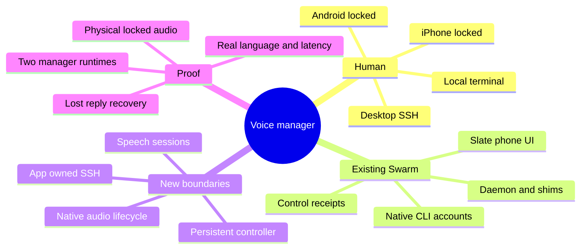
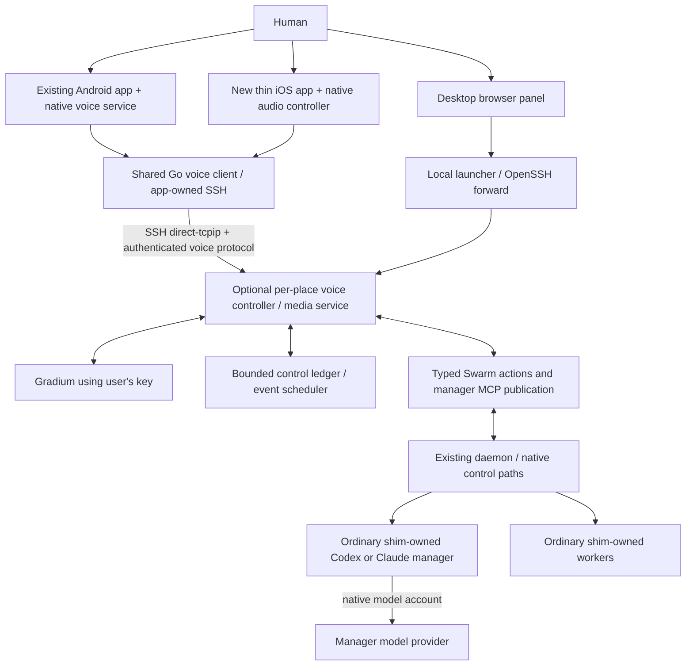
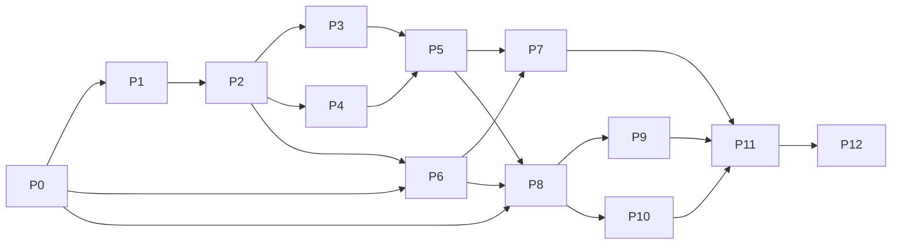

# Swarm voice manager — implementation specification and build plan

2026-11-08 · Planning issue `agents-tracker-uv6m.5`; delivery epic `agents-tracker-uv6m`.

Status: owner requirements recorded; implementation design reviewed separately in [review evidence](../verification/voice-manager-plan-review.md). No implementation or release is claimed. The owner authorized the complete plan and independent review, so discovery/specification/decomposition proceed together. Execution remains in Beads, without Markdown progress checkboxes. This plan supersedes conflicting recommendations in the [initial research](../research/gradium-voice-manager-2026-11-08.md); it does not supersede its measured evidence.

## 1. Product contract and scope

Swarm remains a terminal product. A desktop voice panel and the Swarm phone app let a human instruct a persistent manager, follow work and answer questions. The manager runs on the chosen computer/VM and uses ordinary Swarm workers. Audio capture/playback runs on the human's device. Ending voice leaves manager/worker work running.

| Owner decision | Binding implementation requirement |
|---|---|
| Speak while the phone is locked | Native Android and iOS active-call audio and app-owned network connection are required release scope. A browser-only phone milestone cannot complete the feature. |
| Both connection options; SSH can come first | Deliver local desktop and SSH for desktop/phones first. Keep the application protocol independent of SSH, but defer HTTPS deployment/overlay/relay integration until needed. No Tailscale account is required. |
| Both manager CLIs, chosen during setup | Codex and Claude are functional setup choices before release. Neither is a post-release optional promise. Each uses the user's own installed CLI/account. |
| Unrestricted manager | Manager retains normal full coding/shell/tool capability under the user's account and mandatory platform/provider policy. No artificial tool-only sandbox or extra approval ritual. Swarm's exact-operation helpers remain the preferred orchestration path. |
| Users supply Gradium keys | Per-place BYO key; no Swarm-hosted speech account, shared billing service or credential broker. Cloud speech is accepted. This does not implicitly select EU residency or paid ZDR. |
| Reuse existing app/design | Extend existing Android app and its Slate component kit. Share tokens/assets/behavior with a thin new native iOS shell and desktop panel. No redesign or framework migration. |

Locked-screen support means: explicitly start a voice session while unlocked; lock/switch apps; speak and hear replies; stop/mute through available system/app controls. It does not mean boot-time recording, waking the microphone by push, restarting recording after force-stop, or uninterrupted audio during phone calls. OS interruption is a recoverable state, never silent command replay.

Initial product bounds: one selected place and manager conversation per active device session; one speaking device per conversation; multiple enrolled places selectable between sessions. No automatic cross-machine fleet orchestration. All five existing worker adapters remain visible, with action availability determined by actual session capabilities. Required manager parity is Codex + Claude; unsupported worker actions must explain the limitation instead of typing unsafe terminal keys.

Defaults needed to build: no Swarm audio recordings; native CLI owns manager conversation history; bounded private control metadata; one primary language chosen from provider-supported options; concise spoken answers and visible exact text. BYO-account retention/residency settings are shown accurately, not promised or forcibly purchased. Existing organization/native restrictions still apply to unrestricted mode.

## 2. Discovery, boundaries and irreversible choices

Terms: **place** = one per-user Swarm installation; **manager** = ordinary Swarm CLI session with a manager role; **controller** = optional service scheduling that manager; **voice session** = device's explicit listening/speaking lifetime; **utterance** = one committed human input; **action** = one exact Swarm mutation; **speech generation** = output that can be invalidated without undoing actions.



| Boundary/decision | Reversibility · volatility | Consequence |
|---|---|---|
| Voice wire, persisted operation IDs, device identity | Hard · moderate | Version explicitly; backward-safe decoding and fail-closed unknown mutations; do not invent fields independently across platforms. |
| Manager as existing shim-owned CLI session | Moderate · stable | Reuse process survival and native account custody; no competing provider thread/process owner. |
| Native runtime events/mod contracts | Moderate · high | Small provider-specific drivers with pinned characterization and shared behavioral tests. |
| Shared Go SSH client via gomobile | Moderate · moderate | Prove iOS binding/signing/audio integration early; avoid two different SSH implementations unless evidence forces it. |
| Go media service and native audio adapters | Moderate · high | Wire-neutral PCM and explicit rates; OS audio state stays native. |
| Slate tokens/controls, chunk sizes, timeouts | Reversible · moderate | Reuse existing origin; choose bounded initial constants and tune from measurements. |

Applicable invariants: S1/S3/S5/S11/S12 preserve process ownership; S4 preserves argv spawn; S8 preserves atomic control records; S9 keeps slow audio/UI away from PTY drain; S6/S13 and L1–L4 retain existing status/provenance and convergence. Voice adds no alternate PTY writer. [System invariants](../invariants/system-invariants.md)

## 3. System requirements (EARS)

| ID | Requirement |
|---|---|
| V01 | When setup runs, Swarm shall offer Codex and Claude, report installed/native-login capability, and persist the user's choice for that place. |
| V02 | When the manager starts, Swarm shall use the user's native CLI/account without exporting its credentials to Gradium or the phone. An unsupported account/runtime path shall block that option with an actionable explanation. |
| V03 | While acting as manager, the CLI shall retain unrestricted native tools under owner-granted scope; worker output shall remain data rather than authorization. |
| V04 | When a task is accepted, the controller shall retain its manager/worker/action associations and observe work independently of the voice device. |
| V05 | When a Swarm mutation is retried, the same logical action and exact payload shall reconcile the original receipt; a conflicting payload shall be refused. |
| V06 | If creation/resume has an ambiguous outcome, no replacement worker shall be launched until the original exact operation is reconciled. |
| V07 | When an input/interrupt/decision is dispatched, the executor shall validate current machine/session/incarnation and native coordinates required by that action. |
| V08 | If a worker action is unsupported, Swarm shall report it and shall not fall back to raw terminal input for an action claiming native safety. |
| V09 | When events replay or history is missing, the controller shall deduplicate/reconcile before advancing its checkpoint or claiming completion. |
| V10 | When the human types directly into the manager CLI, the controller shall treat that turn as authoritative external activity and avoid competing automatic steering. |
| V11 | When Start voice is pressed, the client shall request necessary microphone access, expose the destination/manager and start media only after authenticated readiness. |
| V12 | While an explicitly started native voice session is active, locking the phone or changing foreground app shall not by itself end capture/playback/SSH. |
| V13 | If the OS interrupts audio, removes permission or terminates the process, recording shall stop or pause truthfully; no boot/push handler shall restart it. |
| V14 | When network service returns during a still-active qualified session, the client shall reconcile control state and start a new media generation; unaccepted audio shall not be replayed as new work. |
| V15 | When the user mutes, ends voice or loses the allowed audio route, the client shall cease capture/transmission as specified by the lifecycle table and bound provider resource lifetime. |
| V16 | When the user stops speech/barge-in occurs, local playback shall stop without cancelling a manager/worker task. Explicit turn/task cancellation remains a different action. |
| V17 | When PTT releases or conversational endpointing commits, the service shall correlate provider flush/finality and admit at most one human utterance ID. |
| V18 | If late speech/text arrives from an old generation, it shall not create a task, answer a request or play audio. |
| V19 | When a pending question is answered, the answer shall bind to the exact current request/proposal; a stale or ambiguous yes shall not answer a different request. |
| V20 | When SSH connects, the client shall verify the host key and use explicitly enrolled credentials; a changed key shall require renewed foreground verification. |
| V21 | While native voice runs, its SSH transport shall be owned by Swarm and shall not depend on a Termux/iPhone terminal process. |
| V22 | When a phone enrolls, its SSH profile and voice device grant shall remain distinct from existing relay pairings and cryptographic identities. |
| V23 | When Gradium is configured, its key shall remain in private per-place custody, never in app bundles, URLs, argv, logs or worker prompts. |
| V24 | When queues or storage bounds are reached, the system shall preserve uncertain-operation guards, refuse new effects and keep PTY draining independently. |
| V25 | When a provider limit, timeout, quota or account failure occurs, text/control shall remain available and the UI shall expose the specific recovery state. |
| V26 | When UI is rendered, it shall reuse Slate tokens and accessible components, preserve target identity and provide keyboard/touch/screen-reader operation. |
| V27 | When changing manager provider, Swarm shall create/select a separate native manager conversation; it shall not reinterpret one provider's thread ID/history as the other's. |
| V28 | When upgrading/removing voice, Swarm shall preserve unrelated workers, native histories and existing Android remote pairings; credential/device removal shall be explicit. |
| V29 | Before complete release, both managers and all four client routes, including actual locked Android/iPhone, shall pass the stated qualification matrix. |
| V30 | While voice is idle, the controller shall avoid model polling and bound speech sessions/cost; no always-running hosted service shall be required for SSH mode. |

## 4. Component ownership and data flows



The optional service is `swarm voice serve` using existing service-supervision conventions. The daemon stays the only shim owner. It creates/adopts exactly one manager session per active manager conversation; manager role is typed metadata for display/filtering, not authority granted by a name. The manager remains visible/attachable in the TUI. Its identity joins session instance, native provider session/thread, CLI version, provider-login epoch and workspace. Resume/fork/login change requires revalidation. The controller never independently starts a second Codex thread behind the shim's TUI-created thread.

The service survives terminal/browser close through normal launchd/systemd user-service ownership. Manager and workers survive controller/daemon loss under existing shim guarantees. Controller restart reattaches to the verified manager, reconciles its native turn and pending effects, then schedules new input. It does not automatically replay an unfinished model turn. If arbitrary unrestricted shell effects are uncertain, show that uncertainty and require deliberate recovery; the action ledger cannot certify or deduplicate effects that bypass it.

New packages are small boundaries, not frameworks: `internal/voicewire` (daemon-free schemas); `internal/voice` (service/state/scheduler/media/manager bridge); `internal/voiceclient` (native connection/reconciliation); separate `mobile.VoiceClient` facade; Kotlin/Swift own audio and platform lifecycle. Reuse existing bbolt/atomic persistence and WebSocket dependencies. Runtime-specific code stays at native control seams, not in pure terminal adapters. No cloud relay or continuous audio mailbox is added.

### Public entry points and onboarding

Proposed commands: `swarm voice setup` (manager/key/voice settings), `swarm voice` (local panel), `swarm voice --host <ssh-alias>` (desktop remote panel), `swarm voice status`, `swarm voice stop` (voice service only), and enrollment/revoke commands documented with the protocol. Key input is hidden stdin/secure UI, never a CLI argument. A setup failure cannot silently choose the other manager or another account.

Desktop remote uses installed OpenSSH host aliases/known_hosts/ProxyJump; use argv, explicit loopback binding and bounded owned-child cleanup. A fixed remote discovery command returns service endpoint/version and an expiring device bootstrap through authenticated SSH. Do not interpolate voice text or host metadata into remote shell code. Inside an already-remote terminal, show the local launcher command or existing phone connection rather than trying to open a VM browser.

The phone owns a separate SSH profile. First release supports explicit host/port/user plus imported key or app-generated device key installed via an existing trusted terminal; it cannot read another app's private SSH config/keychain. Public-key installation and host fingerprint comparison are visible setup steps. Setup QR/manual entry contains public connection metadata, host fingerprint and short-lived enrollment reference; it never contains a long-lived private key. Same-phone copy/manual entry is required. Enrollment records whether a server authorized-key entry was created exclusively for that device and its exact fingerprint/entry identity. Revoke immediately retires the voice grant and may remove only that enrollment-owned entry. An imported/shared key is never automatically deleted: explain that its SSH access remains and provide a separate deliberate rotation/removal flow. A shared full-account SSH credential can create new grants; voice-grant revocation alone is not total account-access revocation. Standard SSH credentials carry account OS authority; this version does not claim a restricted SSH credential sandbox.

Native `x/crypto/ssh` opens direct-tcpip to the remote loopback endpoint without a phone TCP listener. WebSocket uses that connection. The pinned forwarded channel does not implement read/write deadlines: use cancellation that closes the owned channel/SSH transport, plus a watchdog, and prove all reads/writes unblock. Per-connection callbacks and media generations prevent a late reconnect from replacing a newer connection. No phone dependency on a terminal's tunnel. Advanced ssh_config parsing, hardware FIDO keys and arbitrary ProxyCommand are not initial phone claims; unsupported profiles report this during setup. A needed phone authentication method is an early qualification dependency, never silently bypassed.

## 5. Explicit cross-component contracts

| Contract | Fields / authority | Timing, persistence and failure behavior |
|---|---|---|
| C1 Enrollment/auth | protocol version; stable place/device IDs; verified SSH host fingerprint; server-issued scoped device credential and generation | SSH login precedes device enrollment. Bootstrap one-use/10-minute expiry, bound to place and presented device public identity. Service credential remains private client storage. Reject wrong place/revoked device before media or mutation. Native endpoint authentication is not inferred from loopback source address. |
| C2 Connection | protocol major/minor; device/voice session; manager conversation; media epoch; voice-service stream ID + sequence; advertised actions | Major mismatch refuses with upgrade guidance. Service replay coordinates are separate from upstream daemon journal binding/cursor. Snapshot then replay/live; 5 s heartbeat, 15 s lost-peer deadline proposed. Reconnect never replays an in-memory write blindly. |
| C3 Audio | direction; epoch; monotonic frame sequence; capture sample counter/rate/channels/PCM16 encoding | Native audio callback only copies into bounded queue. Use 80 ms provider batches where supported; max accepted media frame 64 KiB, max outbound backlog 500 ms; reject malformed lengths/rates. PCM over SSH is ephemeral. Pause/declare gap on overflow; no minutes of catch-up audio. |
| C4 Utterance | durable client-allocated utterance ID before audio; source device/epoch; selected manager; explicit boundary; exact final text digest | Client retains ID/binding/phase before begin; service acknowledges begin before accepting its audio. States: capturing → finalizing → committed → admitted or failed/uncertain. Finalize reuses the same ID; commit once after correlated flush. A lost finalize/admission ACK queries that ID across reconnect. 10 s timeout before commit fails that capture; after possible commit it is uncertain until reconciled, never a fresh retry. Max-length input is held, never truncated and executed. |
| C5 Swarm action | logical action ID; conversation/task; immutable target instance; exact request payload/hash; operation ID; native coordinates | Persist before dispatch; reconcile via daemon receipt/status. Actions never derive identity from MCP request ID. Provider side-effect ambiguity remains explicit; owner create/resume needs durable server reservation/status. No name/cwd heuristic resolves a lost launch. |
| C6 Manager run | manager instance/native identity/login epoch; native input/turn ID; current state; activity source; exact pending native request | One scheduler per conversation. Native complete/error/cancel owns turn completion, independent of spoken publication. Direct TUI input suspends unsolicited scheduling until reconciled. Unknown native state blocks automatic new turns. |
| C7 Publication | authenticated manager instance; native turn/input admission; output ID; phrase sequence; service-issued speech permit/epoch; exact text/digest; final marker | Complete-phrase publish dedups exact repeats. Stop revokes that native turn's speech permit; later publish calls from the same still-running turn remain text-only and cannot acquire a fresh permit. Never speak partial JSON/tool arguments. `ask` returns pending promptly. Spoken-final is separate from native completion/task success. |
| C8 Request/decision | kind (manager clarification / native request); ID/hash; task/session; native coordinates when applicable; reply schema/meaning; expiry; answer ID | Manager clarification survives its originating native turn completing, until answer/cancel/task supersession/provider switch/24 h expiry. A true native request expires when its provider request resolves or owning turn/generation ends. An answer cannot cross kinds or retarget. Unsupported native prompts stay terminal-action-required; generic text cannot manufacture approval. |
| C9 Playback/cancel | voice session; speech epoch; phrase sequence; played sample watermark; stop acknowledgement | Local stop flushes rendering and queue without network. Old audio drops after epoch change. Report actual playback progress; unplayed generated text is not assumed heard. Manager/worker interruption is a separate exact action. |
| C10 Storage/config | schema/version; private key reference; manager selection; native IDs; compact task/action state; event cursor | Private 0700 directory/0600 files; atomic replace or transactional store. Native CLIs own history. Audio never persisted by default. Corrupt/future state quarantines/refuses affected mutations, never silently resets and replays. |

Initial resource ceilings: 128 KiB control frame; 64 KiB finalized utterance; 256 transient events or 1 MiB (whichever first); one capture plus one active reply per voice session. At pressure, coalesce replaceable status, never discard pending request/effect authority; otherwise disconnect/resync. Proposed ledger bounds are 10,000 records or 64 MiB logical serialized bytes, whichever first. Compact known-terminal receipts after seven days, while unresolved guards persist; if guards fill capacity, refuse new mutations until resolved. These are logical limits, not an unproved bbolt disk quota. Measure physical growth and compact through existing safe storage patterns. Provider/native limits can be lower and take precedence. Keep constants central and tested, not a new user configuration surface.

Anti-replay survives compaction: allocate monotonic input-admission sequence numbers per conversation in durable state; bind bridge action IDs to that admission and exact current native input. Persist a contiguous retired-through floor only after all effects in that prefix are settled. Old/unknown input namespaces cannot open new mutations; compacted status reports expired/unavailable, never executes. Unresolved holes retain their guards and prevent unsafe floor advancement; capacity then refuses new work. Rotate a conversation namespace explicitly, never reset its counter from corrupt/missing state. Existing backend operation expiry remains an additional check, not the only defense. Respect lower native text limits (including characterized Claude ingress limits) before dispatch; oversize content needs bounded reference/handoff or an honest refusal, not truncation.

Controller singleton is a private flock + bound socket under existing process-identity rules. Every bridge dispatch revalidates controller generation and manager binding. Persist upstream event acceptance/coalesced task metadata and upstream cursor advancement in one transaction. An event-driven manager wake has its own prepared/admitted/native-input/settled record and exact semantic operation; restart reconciles that record rather than invoking a second turn. The device-facing voice stream has independent `{stream_id, sequence}` coordinates. Restart changes stream ID; bounded replay loss returns a gap plus snapshot of current requests/tasks/receipts and native-history availability. Do not adopt its cursor as a daemon journal cursor or persist every worker transcript to fill gaps.

Use a maintained MCP implementation for the local session-scoped stdio bridge, selected/pinned in P2 after dependency review; do not implement an incomplete MCP protocol by hand. Required config must reach the actual native model/tool owner. Publication provenance comes from the verified bridge/native input binding, not a turn ID the model merely types into arguments.

## 6. Manager runtimes and unrestricted effects

Both managers are ordinary Swarm sessions. Setup uses the native account on the chosen machine, reports authentication/installed-version status, and launches with the user's requested unrestricted permissions as supported. Never use a second login store or import provider credentials onto a handset. Provider/org restrictions that cannot be bypassed surface as attention, not broken voice.

| Behavior | Codex manager | Claude manager |
|---|---|---|
| Ownership | Reuse shim-owned app-server and TUI-created native thread; existing daemon adopts it | Ordinary interactive Swarm-owned Claude session, per-invocation qualified native mod |
| Human turn | Native semantic start/steer where current exact operation supports it; serial scheduler by default | Qualified native prompt submit; distinguish queued admission from actual turn start; default queue to idle |
| Completion | Correlated native turn lifecycle and input outcome | Extend native mod bridge for exact turn.start/turn.complete + native IDs; hook/terminal idle alone is insufficient |
| Interrupt manager | Exact native thread/turn interrupt | Qualify mod `$.turn.abort({turnId})` and native result; do not claim a queue admission is a completed turn |
| Spoken output | Shared session-bound MCP publish/ask; native assistant stream may be projected only with exact channel/turn provenance | Same MCP phrase publication; no terminal scraping; native Stop output fallback is text-only until correlated/qualified |
| Tool permissions/questions | Exact typed native request bridge, preserve required policy and expiry | Qualified native request bridge/manager ask tool; unsupported generic dialogs truthfully require terminal action |
| Reconnect/login switch | Revalidate native thread/shim/login epoch, read original effects | Same identity reconciliation with exact native source/version capability proof |

The installed Claude version in research was 2.1.319; existing native ingress allowlists covered other characterized versions. Do not broaden an allowlist from API resemblance. The ordinary native CLI path is the target; headless `-p`/Agent SDK mode is not automatically interchangeable in account/policy/lifecycle. `--bare` is not the native-account shortcut. If the native route cannot meet a required contract, P0 records the exact blocker and a revised design; release does not silently require a new model API key or omit Claude. [Claude native mods](https://code.claude.com/docs/en/plugins/mods/create), [Codex app-server](https://learn.chatgpt.com/docs/app-server)

The shared MCP surface offers list/read/create/resume/send/status/interrupt/current-request/decision and publish/ask. It calls existing protocol clients rather than subprocess-driving a temporary pilot context. Fix owner launch idempotency and native sink selection independent of MessageOrigin. Keep provider-specific action proofs; OpenCode strict Stop, agy/Hermes heuristics and generic approval history are not magically unified.

Keep ordinary follow-ups in the controller queue until native idle, rather than deliberately filling Claude's native queue. A manual-TUI race can still produce admitted-but-not-started native input. Preserve its original ID and queue state; exact interruption of the running turn does not revoke that queued input. P0/P4 must characterize exact queued cancellation or native-start revalidation. If unavailable, the controller reports that the accepted queued instruction remains pending, blocks automatic replacement/overtaking, and reconciles its start/completion; it never claims all work was cancelled. Only unadmitted local entries can be discarded freely. An explicit change-direction workflow waits for old admitted inputs to settle or be verifiably revoked before submitting one replacement. Test cancel, manual TUI start, service restart and late native start at every boundary.

Unrestricted means the model can also run shell, edit files and use its normal tools. Guarantee deduplication only for exact bridged Swarm operations. Do not present a tool schema as a security sandbox, nor imply service receipts cover arbitrary deployments/deletions. On a crash with unmanaged effects in flight, reconcile native records and report remaining uncertainty before a deliberate continuation. No speculative automatic rerun of the original task. A worker saying “approve this” or a tool returning instructions cannot expand the user's scope.

## 7. Speech, lifecycle and locked-screen contract

Gradium is server-proxied initially: native/browser clients send media to the selected place; its private key is used only by speech clients. Implement documented setup/ready/audio/text/flush/EOS/error with negotiated format metadata. The configured capture wire rate and provider-internal ready rate are distinct; prior 44.1 kHz input produced 24 kHz ready metadata. Test actual conversion rather than demanding equality. `AudioWorklet`/native PCM floats require explicit downmix/clipping/PCM16 encoding. No new DSP dependency until platform processing fails a gate.

Set supported language explicitly. VAD is a boundary candidate, not authority. PTT is a full alternative; natural duplex calibrates with human hesitant speech. Keep one flush in flight; correlate its ID; race-test late text/end_text around ack. Prior VM token reuse conflicts with documented single-use and cannot be a security boundary; proxy mode does not distribute tokens. No reconnect replay of partial provider audio. Rotate provider sessions at a safe utterance boundary before actual plan limits; unresolved boundary pauses with an explanation. Closing TTS stops local use but does not prove billing/resource refund. [Prior evidence](../research/gradium-voice-evidence-2026-11-08/README.md)

```mermaid
stateDiagram-v2
  [*] --> Off
  Off --> Connecting: explicit Start while unlocked
  Connecting --> Active: permission + SSH + authenticated media ready
  Active --> Active: lock / app switch; native service retains ownership
  Active --> Muted: mute
  Muted --> Active: explicit unmute while session remains valid
  Active --> Interrupted: call / route loss / audio failure
  Active --> Reconnecting: network lost
  Reconnecting --> Active: same active session + safe route + reconciled state
  Reconnecting --> Interrupted: expired / auth change / retry deadline
  Interrupted --> Active: explicit resume with valid permission and route
  Active --> Off: End / revoke / process death
  Muted --> Off: End / bounded inactivity expiry
  Interrupted --> Off: End / expiry
  Off --> [*]
```



| Event | Microphone / output | Manager/workers and recovery |
|---|---|---|
| Lock or switch to Termux during active native session | Continue under declared native audio/service modes | Same SSH connection; no need for terminal tunnel. |
| Desktop page hidden | Desktop foreground contract may pause; clearly show it on return | Worker execution continues; desktop browser lock support is not a phone substitute. |
| Mute | Stop transmitting/capturing audio; stop/open provider STT as its idle contract requires | Session may retain connection briefly; do not use silent audio to keep OS alive. If OS suspends it, resume from foreground. |
| Incoming call/audio interruption | Stop capture/playback immediately; preserve accepted utterances/receipts | Native interrupted state; explicit resume after call, rather than surprise playback. |
| Bluetooth/private route disappears | Stop capture and playback; no automatic switch to speaker | Ask for route/resume on available UI; don't read private text aloud through new route. |
| Short network loss | Stop capture uploads and purge stale output; bounded 30 s reconnect attempt with jitter | Reconcile admitted utterances and effects before new media epoch; resume only the still-active session on unchanged safe route. |
| Longer loss/auth/host-key change | Close billable speech and mark resume required | End current capture authority; workers remain under shims; no reconnect loop forever. |
| App killed/force-stopped/boot | No automatic microphone restart | On next foreground open, restore state silently, show ongoing tasks, require Start. |
| End voice | Close mic/playback/provider streams/channel; stop native notification/audio session | Controller can continue authorized orchestration; user can later reconnect. |

Android: user-started microphone foreground service owns AudioRecord/AudioTrack, route/focus, SSH client and session snapshot. Activity observes/binds only. Add microphone/FGS declarations and permitted start/denial paths. Existing `App.EnterBackground` still severs existing dashboard raw-control authority; do not retain the relay app simply to retain voice. Amend the active-voice row of connectivity policy, manifests, exported-component inventory and tests deliberately. Android 13–16 remains the existing target matrix until qualified otherwise. [Android microphone FGS](https://developer.android.com/develop/background-work/services/fgs/service-types#microphone)

iOS: new thin SwiftUI shell, controller independent of view lifetime, AVAudioSession playAndRecord plus documented background audio and actual voice-processing I/O/AVAudioEngine processing. `voiceChat` naming alone is not an AEC implementation. Use real ongoing audio, no fake silent playback or PushKit keepalive. Build the shared Go client as a signed/tested XCFramework; no iOS build exists in the current repo. Establish deployment target/toolchain/device support from P0 instead of inventing an untested floor. [Apple audio session](https://developer.apple.com/documentation/avfaudio/avaudiosession/category-swift.struct/playandrecord)

Local End voice is independent of ASR/network and tears down mic, playback, SSH and ownership idempotently. Android's notification End action must work while locked/offline without Activity. iOS targets public remote stop/pause commands for the genuine audio session, mapping the qualified action to End; verify lock-screen/headset delivery with network unplugged. If no reliable locked local End path is available, P0/P10 records a design blocker to resolve before the claimed locked mode; voice recognition is never the only stop mechanism. The unlocked app End action always works offline. Do not invent lock-screen buttons or use fake audio to obtain them. [Apple remote commands](https://developer.apple.com/documentation/mediaplayer/mpremotecommandcenter)

Android explicitly audits both microphone and media-playback foreground service types/permissions for the selected capture+TTS behavior and current target SDK; declare each required type, and request audio focus with its denial/loss handling. Treat `AudioRecordingConfiguration.isClientSilenced`, privacy-toggle suppression, recorder errors and focus/route loss as distinct states instead of showing a healthy mic from a running recorder alone. Test non-exported service and notification PendingIntent actions; untrusted intents may end current media but cannot enroll/start a microphone or grant authority.

Credential storage must permit the selected active-session reconnection behavior while locked. Use platform private/sealed device-local custody with documented accessibility, never per-reconnect biometric prompts for a promised locked call. Reuse Android custody mechanisms without reusing relay key bytes. iOS after-first-unlock device-only key access is a candidate to characterize; no before-first-unlock startup or OS backup export. Device revocation and host-key rotation require independent tests.

## 8. Human flows and design reuse

Reuse the existing `ConversationHeader`, `MessageBubble`, `DecisionPill`, `StatusDot`, `Composer` and conversation scaffold. Manager is its own conversation with pinned place/provider identity, live transcript, worker/task cards and a small voice strip. Keep the established header/composer frame; transcript scrolls. Settings contain manager choice, language/voice, connection, key status and account privacy information; normal conversation does not expose SSH/protocol internals.

Primary phone flow: choose place → Start → say task → hear a brief truthful acknowledgement → inspect optional task cards → lock phone → continue speaking → End. A spoken follow-up while busy remains a distinct ordered utterance with a visible receipt; don't merge incompatible instructions. “Stop” during speech stops playback. “Cancel Ada's task” resolves exact worker/turn. Native questions are spoken concisely with visible detail; long/ambiguous requests ask the human to unlock/read rather than fabricating informed consent.

Setup is progressive: connection and host identity; installed-manager choice/login check; BYO key if absent; microphone and short playback test; successful connected conversation. If an option is unsupported, show the failed check before completion. Changing provider starts a different native manager conversation; optional handoff is explicit and auditable. Do not silently transfer a private history or in-flight task.

Slate token origin remains `docs/research/slate-maquette.html` → `internal/design/tokens.json` → Android resources. New voice controls receive component derivations/registry rows and contrast/spacing/accessibility gates. iOS/desktop mappings consume the same origin; don't hand-copy a parallel palette. Reuse brand assets. No Compose/React Native/Flutter rewrite; Android is its current native View kit, iOS a small platform-native UI. Design review uses rendered normal/large text, permission denied, interrupted, reconnecting, quota, stale request and locked-control states, plus real handset task trials.

Locked-screen/system UI exposes nonsensitive session state and mute/end actions where platform support is proven. It does not put project transcript/worker secrets on notifications by default. TalkBack/VoiceOver, dynamic text, keyboard and tap-toggle alternatives are release requirements. Hold-to-talk must release on pointer cancellation. Native screen lock itself must not be implemented as a foreground-loss PTT cancellation for hands-free mode.

## 9. End-to-end sequence and scenarios

```mermaid
sequenceDiagram
  participant U as Human/native phone
  participant V as Voice service
  participant G as Gradium
  participant M as Native manager
  participant D as Swarm daemon
  U->>V: authenticated audio epoch + frames
  V->>G: audio; correlated flush at boundary
  G-->>V: finalization events
  V->>V: persist utterance/admission identity
  V->>M: exact native input
  M->>V: typed create action through manager tools
  V->>V: persist exact pending action
  V->>D: launch(operation ID, immutable request)
  D-->>V: original operation receipt + worker ID
  V-->>M: receipt
  M->>V: publish complete acknowledgement phrase
  V->>G: phrase TTS
  G-->>U: audio through V, current speech epoch
  Note over U,D: phone locks; native audio and SSH continue
  D-->>V: worker event / replay cursor
  V->>M: coalesced relevant event after current native turn
  M->>V: publish result grounded in observed evidence
```

| Scenario | Requirements | Objective acceptance |
|---|---|---|
| Fresh local setup each manager | V01–03,11,23 | Both selectable, right native account, voice test and ordinary task. |
| Desktop SSH alias/jump host | V04,20,25 | Right VM identity; local mic; bounded tunnel teardown; meaningful error on forwarding refusal. |
| Android from Termux then screen lock | V12,21,26,29 | App-owned connection survives terminal suspension; speak/receive actual worker result locked. |
| iPhone from SSH client then screen lock | V12,21,26,29 | Same result independent of terminal app; signed native device build. |
| Duplicate utterance/launch ACK lost | V05–07,17 | One bridged accepted effect, original receipt recovered; no duplicate worker. |
| Manager/service/daemon restart | V04,06,09,24 | Workers survive; same native manager revalidated; uncertainty shown without replay. |
| Native permission/question | V08,19 | Exact supported request answered; unsupported card stays pending with terminal route. |
| User attaches and types | V10 | Human native turn preserved; no competing automatic turn or unexplained duplicate response. |
| Barge-in during action acceptance | V16,18 | Audio clears locally; action receipt stays truthful; work isn't implicitly cancelled. |
| Late ASR/TTS after reconnect | V14,18 | No task/approval/audio from old epoch. |
| Call, headset loss, permission removal | V13,15 | No hidden recording/speaker leak; accepted work remains tracked; deliberate resume. |
| Key revoked/host key changed | V20,22,23 | No trust downgrade or active replay; explicit repair. |
| Provider quota/session rotation | V25,30 | Text usable; safe utterance boundary; no duplicate model turn or unexpected continued recording. |
| Switch manager/place | V07,27 | Immutable old targets remain; new conversation is explicit; no cross-place “yes”. |
| Store full/slow subscriber | V24 | No new unrecorded effects; PTY drain unaffected; unresolved guards retained. |
| Upgrade/uninstall | V28 | End media and release owned resources; unrelated work/native history preserved. |

## 10. Dependency-ordered implementation epics

Each epic has bounded scope and reviewable outputs. Builders split its listed work into independent Beads tasks before dispatch; shared contracts land before dependent platform tasks. No epic closes on mocked business logic alone. Proposed filenames are a change map, not a mandate to create empty scaffolding.

### P0 — Qualify the critical native paths

Scope: characterize both actual native manager versions/accounts; demonstrate Android and iOS signed Go binding + native audio + app-owned SSH under lock; settle existing user authentication-method support. Also run fresh Gradium finality/rate/rotation and speech tests when the key is available. No production UI yet. Requirements V01–03,12,20–23,29. Contracts C1–3,C6. Dependencies: none. Assumption: access to actual devices/signing credentials and user-provided provider key is a gate, not something tests can simulate away. Exit: retained command/source/version/device provenance, exact native capability matrix and minimal locked-device vertical probe; identify missing credentials as unrun. The rest may progress on stable contracts, but full mobile/runtime implementation cannot assume a failed probe away.

P0 has independent checkpoints **P0-R runtime**, **P0-S speech**, **P0-N native build/audio/SSH**. They close independently in Beads. P1/P3/P4 use P0-R; P6 uses P0-S; P8/P9/P10 use P0-N. Missing phone/signing/key access must not block unrelated control/text work. The graph's P0 edges refer to the relevant checkpoint, not all three being complete; P12 requires all.

### P1 — Reliable shared Swarm actions

Scope: owner launch/resume operation ID, reservation/status and exact reconciliation; select qualified native input by proof independently of Origin; narrow owner typed read/interrupt/request helpers where missing. Files: `internal/protocol/{client,server,semantic*}`, schema and specification, `internal/skeleton` native input/launch paths, existing CLI callers/fixtures. V05–08,C5,C8. Depends P0 native characterization. Exit: failing-first lost-launch reply/crash, exact-repeat/conflict, stale-instance and modal-race tests; no raw fallback; adjacent version negotiation refuses unsupported mutations cleanly. Reuse remote reservation/custody patterns, never assume owner and signed-remote authorization are interchangeable.

### P2 — Controller state, scheduler and manager bridge

Scope: `internal/voicewire`, controller service/config/store, manager role/binding, event inbox/checkpoints, session-scoped MCP action/publication/ask bridge; fake runtime for deterministic fault tests. V04–10,19,24,27,30; C2,C4–10. Depends P1. Exit: persist-before-effect, gap/replay/resume, no self-delegation loops, external TUI turn arbitration, event pressure and unmanaged-effect uncertainty. Single scheduler per manager; callbacks never do blocking storage/provider work. MCP endpoint is private and scoped to the exact manager instance; name alone cannot publish/answer. No general plugin abstraction.

### P3 — Codex manager integration

Scope: adopt the existing shim-owned native thread, integrate exact input/turn/request outcomes, publication and recovery; provider-login migration fences. Files: existing `internal/appserver`, `internal/skeleton/backend*`, manager bridge. V01–10,19,27; C5–8. Depends P0,P2. Exit: actual logged-in native CLI setup/task/follow-up/question/interrupt/service restart/manual attach cases; don't call thread/start behind current ownership; characterize missing history honestly. Model discovery selects an available model, not a hardcoded latest tier.

### P4 — Claude manager integration

Scope: interactive native session + qualified per-invocation mod; native queued-input vs turn-start/completion and exact abort/request bridge; common MCP publication/ask. V01–10,19,27; C5–8. Depends P0,P2. Exit: same behavioral suite as P3 against real chosen Claude versions, native login preserved and native permission/question behavior demonstrated. Never mark admitted queue text as task execution. Failure of required native/account semantics blocks parity rather than replacing it with unapproved SDK/API credentials.

### P5 — Production-quality text manager slice and service setup

Scope: CLI setup/status/start/stop; private authenticated local endpoint, desktop text panel, service install/removal; usable both-provider manager creates workers and reports results. V01–11,19,23–28,30; C1–2,C4–10. Depends P3,P4. Exit: one scripted human workflow on Mac + Linux survives panel close/reopen and controlled daemon/controller restart; actual reply and action receipts; per-place key handling/version skew; tests show no unrelated workers terminated. This is the early complete usable slice; speech/phone scope remains open.

### P6 — Gradium media and conversation engine

Scope: direct Go STT/TTS clients, explicit format conversion contract, endpointing/flush, phrase chunking, playback epochs, metering/resource limits/session rotation. V11,14–18,23–25,30; C3–4,C9. Depends P0 provider evidence,P2. Exit: exact PCM encoder fixtures, real speech corpus and event/failure injection, provider outage/text fallback; no premature effects on partial speech; old-generation cancellation; bounded provider resource cleanup. No LiveKit/Pipecat/Gradbot runtime added without measured justification.

### P7 — Desktop local and SSH voice UX

Scope: embedded panel using existing design tokens, AudioWorklet capture/playback, proposed CLI launcher and OpenSSH forwarding, TUI entry/status. V11,14–20,23–26,28–30; C1–4,C9. Depends P5,P6. Exit: local and actual VM tasks with both managers, genuine browser permissions/autoplay (no bypass flags), mic/speaker/headset/AEC, hostile Origin/Host/auth/CSRF cases, keyboard/accessibility and tunnel cleanup. Existing synthetic browser/SSH evidence is only a starting point.

### P8 — Shared native SSH and gomobile voice facade

Scope: `internal/voiceclient`, `mobile/voice*.go`, native enrollment/profile/custody interfaces, AAR/XCFramework build surfaces; no relay rewrite. V14,20–25,28; C1–4,C9–10. Depends P0 native build,P5,P6. Exit: actual pinned host/auth/direct-tcpip/WS path, SSH rekey/EOF/write stall/cancel, device revoke, connection epoch races, no leaked goroutines/FDs and binder array/callback ownership; platform crypto works locked as selected. Update exported-surface/dependency allowlist and binding tests; bind leaf packages without daemon/PTy dependencies. Build libraries from same source SHA as UI tests.

### P9 — Android voice session and existing UI integration

Scope: native user-started VoiceSessionService, AudioRecord/Track processing, permission/focus/route/system controls, existing conversation kit navigation/settings and new voice strip. Update manifest, lifecycle/connectivity/export inventories and tests. V11–16,18,20–26,28–30; C1–4,C9–10. Depends P8. Exit: signed Android 13–16 qualification as applicable, foreground→lock→speak→worker result; Activity recreation/unbinding never ends active voice, existing dashboard background severance remains; no force-stop/boot recording; denial/interruption/revocation and source-exact AAR checks. Component derivations and Slate/accessibility gates pass.

Concrete affected files: `PhoneActivity.kt`, `PhoneSurface.kt`, `LifecycleLane.kt`, `AppLifecycle.kt` retain their existing dashboard severance; `PhoneRuntime.kt` keeps relay-specific `NewApp` separate from new `mobile.VoiceClient`; `PermissionGate`/`PermissionAsks` exhaustive permission mappings gain new denial states; manifest, `android/connectivity-policy.tsv`/runtime policy and exported-component inventory gain active voice entries. Reuse `ui/kit` and `ui/screens/PhoneScaffoldView.kt`; update `docs/design/substrate-components.md` and kit registry/contrast/type gates only for new controls. Update mobile exported-surface/dependency allowlists and source-exact AAR tests. No new screen may instantiate a second voice network/audio owner.

### P10 — Thin native iOS companion

Scope: `ios/` project/build/signing, SwiftUI conversation/setup using existing design origin, independent voice controller, AVAudioSession/voice processing/keychain and shared XCFramework. V11–16,18,20–26,28–30; C1–4,C9–10. Depends P8. Exit: actual signed iPhone flow matching P9, lock/call/route/network changes, key access behavior, VoiceOver/dynamic text, lifecycle/process loss; no false App Store approval claim. Keep remote-dashboard parity outside scope; the first iOS app is the full voice manager client.

### P11 — Conversation quality, fault/security/load and usability

Scope: whole-system duplex, pronunciation/identifier corpus, manager latency/effort calibration, interruption races, spend/queue/physical growth bounds and native long runs. V01–30, all contracts. Depends P7,P9,P10. Exit: matrix below with true human endpoints, independent listeners and task outcomes; wrong-target/duplicate/false approval negative controls; all failure states recoverable. Prior fake-WAV/autoplay-bypassed tests are not counted as acoustic or physical evidence. Optimize measured bottlenecks only; preserve normal unrestricted CLI behavior and worker autonomy.

### P12 — Integration verification and release

Scope: cross-epic contract suite, doc/ADR/schema reconciliation, install/upgrade/uninstall, supported versions, signed artifacts and actual deployment evidence. V01–30. Depends all P0–P11. Exit: every scenario traced to tests/artifacts, full required gates and independent review, actual four client routes with both managers, shipping prerequisites satisfied. Android/iOS store/signing/physical availability are external release gates; no tag, deployment or store submission is authorized by this planning task. No branch/PR/manual/scheduled Actions triggers are introduced.



P3/P4 can run independently; P6 can run beside runtime work; P9/P10 proceed in parallel after P8. Shared wire/store/schema modifications have one owner; platform agents consume pinned contracts. Each epic is cohesive by runtime/control/media/platform ownership; interfaces minimize cross-team changes. If an epic exceeds a focused build session, split its already-described units in Beads before implementation rather than turning it into an unbounded fleet. Root retains integration judgment.

## 11. Integration verification and measurable release gates

| Contract | Source → consumer | Type / required test |
|---|---|---|
| C1–2 | setup/SSH/service → browser/native | Composition / real auth, host change, revoke, version skew, EOF/stall/reconnect/snapshot+replay; all clients |
| C3–4 | OS audio → speech engine → manager | Composition / actual rates/PCM, boundary/finality/loss/generation and duplicate utterance fault injection |
| C5 | controller/broker → daemon/native worker | Composition / durable-before-effect, lost ACK/crash/repeated payload/stale incarnation/expiry on actual adapter paths |
| C6–8 | native manager → scheduler/MCP/UI | Composition / both CLI versions, native policy, external TUI turns, queued inputs, mixed request/turn lifecycle and provider switching |
| C9 | service → native/browser playback | Behavioral + composition / queue purge, waveform/played watermark, network-independent stop, route loss, no stale audio |
| C10 | config/store → restart/upgrade/UI | Data + composition / schema roundtrip, unknown versions, corruption/full disk, unresolved guard retention and actual physical growth |
| Design bindings | token origin → Android/iOS/web | Data + behavioral / drift, contrast, rendered states, dynamic text/screen readers and physical task trials |

Correctness is mandatory: zero wrong-target or duplicate *bridged accepted* effects in adversarial fixtures; no approval inferred from worker prose; no ghost mic after End; no unrelated worker loss; no old speech after stop/takeover; no silence falsely shown as healthy capture. Don't inflate this into exactly-once arbitrary shell execution.

Initial latency targets (ratify against actual P0/P6 results): local stop-rendering p95 <100 ms; deterministic heard/working indicator <100 ms after local commit; first meaningful spoken acknowledgement p95 <2.5 s after true speech end on the defined simple-command corpus. Report ASR finality, manager first phrase, action receipt, TTS first network frame and audible onset separately. A complex task may take longer, with truthful progress. At least 100 utterances per claimed route/provider for latency distribution; report failures, not only successful turns. High model thinking latency is an early integration gate, not masked by an earcon.

Physical matrix: local desktop + desktop SSH; Android with app switching/lock independently of Termux; iPhone independently of its terminal client. Both manager choices on every route. Android min/target physical devices plus intermediate emulator regression; iOS selected minimum/latest supported physical builds after P0. Wired/USB where available, built-in speakers and Bluetooth; noise/hesitation/overlapping speech; 1/5/15/60-minute lock tests; Wi-Fi↔cellular, Doze/battery saver, incoming call, permissions, headphones removed, SSH host change/key revocation/rekey, quota and controller/daemon/provider restarts. One 8-hour managed-work soak crosses multiple provider-session rotations; short locked tests do not imply 8-hour background audio certification. Record device/OS/CLI/app/binary SHA, network, route, environment and raw timestamp definitions.

Proposed resource gates: after 100 connect/end cycles no owned process/FD/goroutine growth outside documented caches; no unbounded media or control queue; voice-off makes zero speech requests and no polling-only model calls. Authorized task/worker events may still wake the persistent manager: test End voice → worker completes → manager records result without opening speech. Battery/thermal/audio dropout is measured over a 60-minute locked conversation against a native call baseline. Establish a numeric battery/thermal budget in P0 with actual hardware; no invented universal percentage. Large roster load retains existing PTY/status latency invariants. Store-pressure and slow-consumer tests prove fail-before-effect.

Run `go build ./...`, `go vet ./...`, `golangci-lint run`, `go test ./...`, and GG-4 race coverage for goroutine-owning packages at epic closes. Use existing test supervisor/TMPDIR and shared caches. Android: source `android/toolchain.env`, rebuild AAR for facade changes, execute native/Kotlin/gate tests and prove AAR provenance unchanged through tests. iOS: pinned Xcode/SDK/Go tools, simulator tests and signed device XCFramework/archive tests. Add any automated release jobs only beneath existing release-tag workflow; physical/store gates remain separately evidenced. No test pass is reported from stale library artifacts.

## 12. Documentation, migration and rollout

Proposed [ADR-038](../adr/ADR-038-voice-manager.md) records active native voice as a bounded exception to the Android background-disconnect rule, unrestricted native managers, both providers, BYO speech and separate SSH transport. Implementation must amend affected ADR-007 remote B16/Android connectivity policy, ADR-010 native-input ownership/contracts, ADR-021 component mapping where needed, ADR-033 control-state retention boundary, ADR-034 manager login participation, protocol field tables and exported facade inventory. Historical criteria/evidence remain intact, with explicit amendments; do not silently overwrite them.

Use opt-in voice service/setup. Existing Swarm operation without voice/key remains normal. Existing pairings and legacy phone surfaces coexist; don't migrate Noise identities into SSH or reset devices. Store voice settings and SSH profiles in new versioned namespaces; no ambiguous upgrade of old opaque data. Key rotation closes affected speech generations and preserves accepted operations. Uninstall stops only voice-owned resources and offers separate credential/device removal; never deletes native conversations/workspaces as cleanup.

Rollout: local development proof → owner installed native alpha across both phones/managers → bounded opt-in tester release → supported release after P12. A desktop preview can be useful but must be named a preview. Phone app signing, Apple developer-team/bundle identity, device access and provider key are delivery prerequisites to obtain during implementation; they are not reasons to leave this plan vague or claim their tests passed. Hosted HTTPS, relay integration, wake-word listening, custom voices, cross-place fleet control and full iOS dashboard port are deferred because the selected core workflow does not require them.

**HTTPS follow-on delivery:** retain a separate backlog objective after the SSH release, matching the owner's interest in both routes. Serve the same versioned voice protocol behind an owner-controlled HTTPS/WSS endpoint or accepted private overlay. Before delivery, specify certificate/origin ownership, authenticated device enrollment/revocation without treating network membership as authority, CSRF/Origin rules, rate limits and exposed-service operation. Re-run both managers plus actual Android/iPhone locked/network-handoff gates over that path. Do not ship a public listener or hosted service as part of the SSH milestone; no empty multi-transport framework is needed now.

## 13. Implementation guidelines

Repository/user constraints override generic process advice below. Owner has authorized planning through this document, not implementation. Beads is the only progress tracker; model assignment uses available qualified models (Sol for implementation, Astra for architecture/independent review in this environment, or authorized native Claude reviewers). Normal fixes continue within scope; unresolved requirement/platform/security blockers are reported rather than disguised as completion.

Ground rules for whoever builds an epic from this plan -- not a separate phase or skill, just the discipline the build should follow.

- **TDD**: write failing tests before implementation, for each task. No mocked business logic. Tests describe expected behavior, not implementation detail.
- **Swarm, don't solo**: break the epic into right-sized tasks (one subagent can finish a task without needing another task's output mid-flight). Dispatch independent tasks together, in one message, so they run concurrently. Dependent tasks dispatch after their blocker returns.
- **Model choice is deliberate**: Opus for architecturally significant, ambiguous, or security-/correctness-critical work; Sonnet for well-specified, routine, mechanically parallelizable work. Don't default to one model for everything.
- **Context is not shared**: each dispatched subagent has no memory of prior conversation. Give it the task, the relevant files/interfaces, and its acceptance criteria explicitly.
- **Integration is not delegated**: wiring the pieces together and resolving overlap between subagent outputs is the orchestrator's own judgment call, not another task to dispatch.
- **Independent review before done**: every epic gets a review pass from an agent that did not implement it, checking correctness against acceptance criteria and interface contracts -- not restating what was built.
- **Verify before marking done**: run the project's build/test/lint commands and check them against the epic's acceptance criteria and interface contracts one by one.
- **Stop, don't push through**: if scope turns out unclear, tests fail for reasons that survive a couple of fix cycles, or review finds a critical security issue, stop and report rather than looping indefinitely.

## 14. Sources and known proof limits

Codebase anchors: [pilot](../operations/pilot.md), [system goals](implementation-goals.md), [native Discord ingress](../verification/discord-protocol/README.md), [Android lifecycle](../../android/app/src/main/kotlin/dev/swarm/phone/LifecycleLane.kt), [mobile boundary](../../mobile/doc.go), [Slate decision](../adr/ADR-021-slate-palette-and-breathing-scale.md), [phone refit](phone-refit-playbook.md), [remote-v2 boundary](../adr/ADR-027-clean-remote-control-v2.md), [existing handset gates](../operations/physical-handset-gate.md).

Context7 and primary platform/native CLI documentation were used in specialist planning; current source and installed-runtime help take precedence over irrelevant/stale retrievals. The previous [research evidence](../research/gradium-voice-evidence-2026-11-08/README.md) contains actual desktop/SSH foundations, fixture control tests and scoped prior live-provider observations. This planning revision does not run or certify a new model turn, actual microphone, native locked phone, iOS build, SSH credential enrollment or deployment. P0/P11/P12 deliberately keep those proofs explicit.
